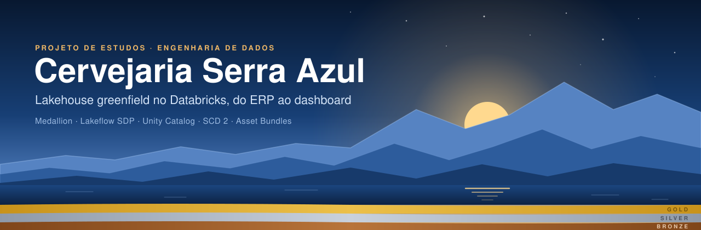
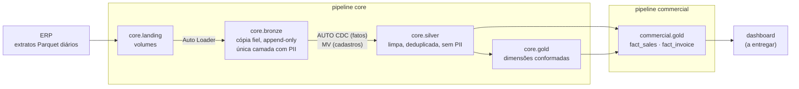
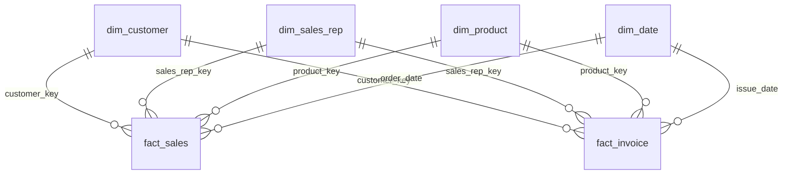

<p align="center">
  
</p>

# Cervejaria Serra Azul: lakehouse de dados no Databricks

Projeto de estudos que simula o trabalho de um Engenheiro de Dados Sênior num projeto *greenfield*: a plataforma de dados de uma cervejaria fictícia, construída do zero no **Databricks Free Edition**. Cada decisão de arquitetura tem o problema, a escolha, as alternativas descartadas e o custo registrados em ADR.

> A Cervejaria Serra Azul não existe. Os dados são sintéticos e vêm com sujeiras intencionais (duplicatas de integração, cadastros imperfeitos, devoluções misturadas com vendas) para que os problemas reais de engenharia apareçam.

## O problema de negócio

Uma fabricante de bebidas com faturamento de ~R$ 2,8 bi/ano, 3 fábricas, 8 centros de distribuição e ~40 mil pontos de venda. Hoje a diretoria consolida planilhas extraídas do ERP com 3 a 5 dias de atraso. A plataforma é entregue em **fatias verticais por domínio**: cada uma atravessa fonte → bronze → silver → gold → consumo e termina com algo visível.

| Fatia | Pergunta de negócio | Quem pergunta | Status |
|---|---|---|---|
| 1. Comercial | "Quanto vendi ontem, por região, marca e canal?" (D-1 até 8h) | Diretor Comercial | 🟨 em andamento |
| 2. Supply chain | "Qual a cobertura de estoque por CD e SKU?" | Gerente de Supply | ⬜ |
| 3. Sell-out | "Sell-in × sell-out: estou empurrando estoque para o canal?" (14 fontes sujas) | Trade Marketing | ⬜ |
| 4. Logística | "Qual o meu OTIF por CD e transportadora?" | Supply e Comercial | ⬜ |
| 5. Data science | Features semanais por SKU × CD para previsão de demanda | Data Science | ⬜ |

Mais detalhes em [caso de negócio](docs/caso-de-negocio.md) e [roadmap](docs/roadmap.md).

## Arquitetura



- **Medallion organizado por fonte e por domínio.** Até a silver, os dados ficam no catálogo `core`, alinhados à fonte: cada fonte é ingerida uma vez. Da gold em diante, cada domínio (`commercial`, depois `supply`, `logistics`...) tem o seu catálogo, e as dimensões conformadas ficam em `core.gold`, com uma definição por entidade.
- **Lakeflow Spark Declarative Pipelines em SQL**, com dois pipelines (`core` e `commercial`) que rodam em série. O job `serra_azul_daily` garante a ordem: um simulador grava na landing a extração diária do ERP, os dois pipelines rodam, e uma verificação final, depois da publicação, falha o job se algum fato, dimensão ou cadastro duplicou.
- **Idempotência provada, com um achado no caminho:** a recarga do mesmo dia não muda nenhuma linha. O primeiro teste de reenvio da extração dobrou a silver de cadastros; corrigida a consulta, o reenvio passou a ser absorvido, com silver e gold idênticas por checksum (ADR-0012).
- **Tudo como código.** Os pipelines e os jobs ficam num *bundle* (Declarative Automation Bundles, os antigos Databricks Asset Bundles). Catálogos e schemas são criados por SQL em `setup/`, porque no Free Edition a API não cria catálogos.
- **Somente batch e serverless**, com uma execução por dia para caber na *fair usage quota* do Free Edition.

## Modelagem da fatia 1

*Star schema* com dois fatos transacionais no grão do item e quatro dimensões conformadas.



| Decisão | Por quê |
|---|---|
| **Dois fatos**: `fact_sales` (pedido, 2.931.839 itens na carga inicial) e `fact_invoice` (nota fiscal, 3.017.600 itens na carga inicial) | Pedido e faturamento são processos diferentes, com datas e regras diferentes. Devoluções entram na NF com sinal negativo, aplicado só no fato |
| **SCD por atributo** em cliente e vendedor | Canal, segmento, endereço e região mudam a análise "como era" (SCD 2). Razão social e status são lidos "como são hoje" (tipo 1). As versões da fonte que não mudam nada rastreado são fundidas (*gaps and islands*): 72.650 versões viram 47.166 |
| **Duas chaves no fato** | A `_key` da versão vigente na data do documento ("como era") e o `_id` durável com `is_latest` ("como é hoje"), o tipo 7 de Kimball |
| **Chaves substitutas determinísticas** (`xxhash64`) | São recalculadas a cada execução sem tabela de controle, e a mesma entrada gera sempre a mesma chave |
| **Membro desconhecido `-1`** com o motivo exposto | Uma venda de cliente ainda não cadastrado não some do total, e a coluna `_is_customer_id_known` diz se o problema é cadastro atrasado ou data fora da vigência |
| **PII só na bronze** | Minimização (LGPD): CPF/CNPJ é validado na silver, e só o resultado segue adiante |

A visão completa, com o porquê de cada regra, está em [modelagem do lakehouse](docs/modelagem-do-lakehouse.md). Colunas e sujeiras de cada dataset estão no [dicionário de dados](docs/dicionario-de-dados-erp.md).

## Qualidade de dados

As regras são *expectations* nomeadas, com três ações: `FAIL UPDATE` para quebra de contrato (chave nula), `DROP ROW` para linha inválida conhecida e aviso para medir. Toda regra aparece no *event log* do pipeline.

| Sujeira da fonte | Tratamento | Números |
|---|---|---|
| Pedido reenviado pela integração, às vezes com status atualizado | `AUTO CDC` na silver, com desempate pelo ciclo de vida do pedido | 821.048 linhas → 805.153 pedidos |
| Itens com quantidade ou valor negativo | `DROP ROW` na silver | 3.038 itens |
| NF de devolução misturada com venda | Tipo pela CFOP; sinal negativo só no fato | 11.158 NFs de devolução |
| CNPJ/CPF inválido | Módulo 11, e dígitos todos iguais contam como inválido; o resultado fica em `is_document_valid`, medido por aviso | 1.336 versões, 735 clientes |
| Cidade com grafias diferentes ("Sta Luzia", "Santa Luzia") | Cidade oficial pelo CEP, antes do cálculo de versões | correção de grafia nunca vira versão nova |

Uma lição registrada no ADR-0010: toda *expectation* precisa dar `true` ou `false`, nunca `NULL`. Uma regra que dá `NULL` justamente no caso que deveria contar mede 0 sem ter medido nada.

## Decisões de arquitetura (ADRs)

| ADR | Decisão |
|---|---|
| [0001](docs/adr/0001-organizacao-de-catalogos-e-schemas.md) | Catálogo `core` alinhado à fonte e catálogos por domínio para a gold |
| [0002](docs/adr/0002-motor-de-transformacao.md) | Lakeflow Spark Declarative Pipelines como motor de transformação |
| [0003](docs/adr/0003-fatos-de-vendas-e-faturamento.md) | Pedido e faturamento como dois fatos transacionais no grão do item |
| [0004](docs/adr/0004-ajustes-de-organizacao-nomes-landing-e-pii.md) | Nomes por entidade, prefixo de fonte até a silver, landing por dataset e PII por minimização |
| [0005](docs/adr/0005-orquestracao-por-job-e-codigo-em-bundle.md) | Orquestração por job e tudo versionado num bundle |
| [0006](docs/adr/0006-dimensoes-conformadas-identidade-scd-e-chaves.md) | Dimensões conformadas: identidade estável, SCD por atributo e chaves determinísticas |
| [0007](docs/adr/0007-retencao-da-bronze-por-tipo-de-extracao.md) | Retenção da bronze pelo tipo de extração |
| [0008](docs/adr/0008-pipeline-core-deduplicacao-qualidade-e-cadastros.md) | Pipeline `core`: deduplicação por `AUTO CDC`, cadastros recalculados e qualidade por *expectations* |
| [0009](docs/adr/0009-validacao-de-documento-digitos-repetidos-e-cnpj-alfanumerico.md) | Documento com dígitos todos iguais é inválido; CNPJ alfanumérico adiado |
| [0010](docs/adr/0010-pipeline-commercial-fatos-chaves-e-membro-desconhecido.md) | Pipeline `commercial`: chaves pela data do documento e motivo do membro desconhecido |
| [0011](docs/adr/0011-dim-customer-tipo-1-pela-ultima-versao.md) | Atributos tipo 1 do cliente pela última versão, e não pela versão aberta |
| [0012](docs/adr/0012-job-diario-extracao-simulada-idempotencia-e-verificacao.md) | Job diário: extração simulada e determinística do ERP, landing sem sobrescrita, idempotência provada e verificação de unicidade |

Um ADR aceito não é reescrito: uma mudança entra por um ADR novo, que emenda ou substitui o antigo. Cada ADR responde "e em produção, faríamos diferente?" e "qual o custo com 10x e 100x o volume?". As regras em vigor estão resumidas numa página de [convenções](docs/convencoes.md).

## Como o projeto é conduzido

O projeto é feito com o [Claude Code](https://claude.com/claude-code). O Claude atua como **Engenheiro de Dados Sênior / tech lead**: decide a arquitetura, implementa e explica cada decisão. O autor acompanha como engenheiro em formação: pergunta, pede alternativas e pode vetar qualquer decisão.

Agentes especializados em [`.claude/agents/`](.claude/agents) dividem o trabalho:

| Agente | Papel |
|---|---|
| `data-engineer` | Escreve os pipelines, o bundle e os scripts |
| `doc-writer` | Transforma decisões em ADRs e mantém a documentação coerente |
| `adr-reviewer` | Revisa cada ADR contra o template, os ADRs anteriores e as convenções |
| `free-edition-checker` | Confere na documentação oficial se um recurso existe no Free Edition |
| `professor` | Responde às dúvidas do autor com os ADRs e o código como material de aula |
| `done-checker` e `interviewer` | Verificam os critérios de pronto e fazem a entrevista do fim da fatia |

Um *hook* ([`databricks_guard.py`](.claude/hooks/databricks_guard.py)) impede os agentes de rodar pipelines, *full refresh* ou SQL destrutivo: essas ações só acontecem com o ok de uma pessoa.

## Estrutura do repositório

```
├── databricks.yml              # bundle: variáveis de catálogo e target
├── resources/                  # pipelines core e commercial, job de carga inicial, job diário
├── src/
│   ├── pipelines/
│   │   ├── core/{bronze,silver,gold}/   # SQL do pipeline core
│   │   └── commercial/gold/             # SQL dos fatos
│   └── jobs/                   # verificação de unicidade do job diário
├── data_gen/erp/               # carga inicial sintética do ERP, simulador da extração diária e manifestos
├── setup/                      # criação de catálogos, schemas e volumes
├── docs/
│   ├── adr/                    # decisões de arquitetura
│   ├── caso-de-negocio.md      # a empresa, as fontes e as sujeiras
│   ├── modelagem-do-lakehouse.md
│   ├── dicionario-de-dados-erp.md
│   ├── convencoes.md
│   └── roadmap.md
└── .claude/                    # agentes, hook e configuração do Claude Code
```

## Como executar

Pré-requisitos: um workspace do Databricks Free Edition e o Databricks CLI autenticado num perfil. Troque o perfil `aws2` em `databricks.yml` pelo seu.

1. Crie os catálogos, schemas e volumes rodando `setup/00_fase0_catalogs_schemas.sql` no SQL warehouse.
2. Valide e implante o bundle:
   ```bash
   databricks bundle validate
   databricks bundle deploy
   ```
3. Gere a carga inicial sintética do ERP na landing (18 meses de história). **Uma vez só:** rodar de novo na mesma landing faria a bronze ler a carga inteira outra vez (ADR-0012):
   ```bash
   databricks bundle run erp_initial_load
   ```
4. Valide o pipeline `core` sem processar dados:
   ```bash
   databricks bundle run core --validate-only
   ```
5. Rode o job diário: extração simulada do ERP → `core` → `commercial` → verificação de unicidade. Sem parâmetros, ele grava todas as extrações que faltam, da última na landing até hoje. Se a carga inicial ficou para trás há muitos dias, isso pode ser muita coisa para uma execução: o simulador tem timeout de 30 min. Para avançar aos poucos, passe uma `extraction_date` próxima da última extração. É o trade-off do ADR-0012: cada execução recalcula a janela do simulador, então avançar aos poucos custa mais no total e menos por execução.
   ```bash
   databricks bundle run serra_azul_daily
   ```
   Para recarregar um dia já gravado, sem gerar o seguinte, passe a data da extração:
   ```bash
   databricks bundle run serra_azul_daily --params extraction_date=2026-10-27
   ```

   **Se o simulador estourar o tempo, apague a extração incompleta antes de rodar de novo:** são os arquivos da extração seguinte à última que o simulador imprimiu no log, em todos os datasets. O `core` nunca os leu (ADR-0012).

A carga inicial e cada execução do job consomem uma parte relevante da cota diária do Free Edition. Rode uma vez por dia. O agendamento do job (05:00 de Brasília) fica pausado.

## Limitações do Free Edition que moldaram o projeto

| Limitação | Efeito no projeto |
|---|---|
| Só compute serverless | Sem dimensionar cluster: otimização por layout de dados e SQL |
| Um SQL warehouse 2X-Small | Dashboard e consultas disputam o mesmo warehouse |
| Um pipeline ativo por tipo | Pipelines `core` e `commercial` em série, encadeados por um job |
| *Fair usage quota* | Volumes modestos, uma execução por dia e *validate-only* antes de rodar |
| Catálogos só por SQL | `CREATE CATALOG` em `setup/`, fora do bundle |

Cada limitação vira um trade-off explícito no ADR correspondente, com o que seria diferente em produção.
