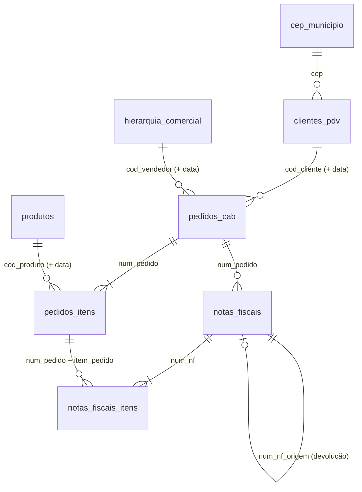

# Dicionário de dados — ERP (carga inicial sintética)

Dados que chegam na **landing** para a fatia 1, como o ERP da Serra Azul os entregaria no go-live. É a "matéria-prima" da bronze: nomes em português, como a fonte manda (a tradução para inglês acontece na silver, ADR-0004).

| Item | Valor |
|---|---|
| Período coberto | 2025-04-19 a 2026-10-18 (18 meses, até D-1) |
| Data da extração | 2026-10-19 (pasta de cada dataset) |
| Formato | Parquet, em `/Volumes/core/landing/erp/<dataset>/2026-10-19/` e `/Volumes/core/landing/ref/cep_municipio/2026-10-19/` |
| Gerador | [`data_gen/erp/erp_initial_load.py`](../data_gen/erp/erp_initial_load.py), job `erp_initial_load` do bundle |
| Gabaritos | `data_gen/erp/manifest_<dataset>.json`: contagem exata de cada sujeira injetada |
| Reprodutível? | Sim. Toda aleatoriedade vem de hash da chave + semente `20261019`; rodar de novo gera os mesmos arquivos |

---

## 1. Como as tabelas se relacionam



**Três tabelas são versionadas:** `clientes_pdv`, `produtos` e `hierarquia_comercial` têm uma linha por versão. A ligação com pedidos e NFs é pelo código **e pela data**: vale a versão cuja vigência contém a data do evento.

**As outras cinco são transacionais ou de referência:** `pedidos_cab`, `pedidos_itens`, `notas_fiscais` e `notas_fiscais_itens` são transacionais; `cep_municipio` é referência. Nenhuma delas é versionada.

### Como ler a vigência

O ERP usa **intervalo fechado**:
- **Início:** `dt_inicio_vigencia` é o primeiro dia em que a versão vale.
- **Fim:** `dt_fim_vigencia` é o **último** dia, o da véspera da próxima versão. Fica nulo na versão vigente.

Na silver, isso vira o intervalo semiaberto `[valid_from, valid_to)` do ADR-0006: `valid_to` = dia seguinte ao fim, ou `9999-12-31` para a versão vigente.

---

## 2. Regras de negócio que atravessam as tabelas

### Canais de venda

| `tipo_cliente` | Canal | Clientes | % do volume (hl) | Como compra |
|---|---|---|---|---|
| `DISTRIBUIDOR` | Distribuidor | 12 | 55,0% | Poucos pedidos enormes (~40 itens, centenas de caixas por item); preço ~26% abaixo da tabela |
| `REDE` | Rede varejista | 2 | 26,2% | ~8 pedidos por dia, um por centro de distribuição da rede; preço ~18% abaixo |
| `PDV` | Venda direta | 39.759 | 18,8% | Um pedido a cada ~4 semanas em média, com poucos itens e poucas caixas; preço cheio |

O **segmento** (`BAR`, `RESTAURANTE`, `MERCADO`, `CONVENIENCIA`, `ADEGA`) é o tipo de estabelecimento do PDV. É ele que muda quando o caso de negócio fala em "mudança de canal". Bares e restaurantes compram mais garrafa retornável e barril; mercados, conveniências e adegas compram mais lata e PET.

### Regiões: geográfica ≠ comercial

- **Região geográfica:** vem da UF do cliente (SUDESTE, SUL, NORDESTE, CENTRO-OESTE, NORTE). A UF está no cadastro; a região é derivada na silver.
- **Região comercial:** vem do vendedor do pedido (`hierarquia_comercial.regiao_comercial`). Tem uma sexta região, **CONTAS NACIONAIS**, que atende as duas redes.

Elas divergem de propósito. As redes têm sede em SP, então **o Sudeste fica com 56% do volume geográfico**, mas na visão comercial esse volume é de Contas Nacionais. Por isso o dashboard usa a região comercial (ADR-0006).

### Ciclo de vida do pedido (`pedidos_cab.status`)

```
ABERTO ──faturamento (D+0 a D+2)──► FATURADO
   │                                   │
   │ (5% dos pedidos)                  └─cancelado depois (0,3%)─► CANCELADO + NF de devolução
   ├──► PARCIALMENTE FATURADO ──2ª NF (1 a 3 dias)──► FATURADO
   └─cancelado antes de faturar (2%)──► CANCELADO (sem NF)
```

| Status final | Pedidos |
|---|---|
| `FATURADO` | 786.692 |
| `CANCELADO` | 18.190 (2.200 depois de faturar) |
| `ABERTO` | 141 (pedidos dos últimos dias, ainda sem NF) |
| `PARCIALMENTE FATURADO` | 130 (aguardando a 2ª NF) |

### Notas fiscais e CFOP

O tipo da NF **não** vem numa coluna própria: vem do **CFOP** (Código Fiscal de Operações e Prestações), como num ERP real.

| CFOP | Operação | Quando |
|---|---|---|
| `5102` | Venda dentro do estado | Cliente na mesma UF da fábrica que atende |
| `6102` | Venda para outro estado | Cliente em outra UF |
| `1202` | Devolução de venda, dentro do estado | Devolução de cliente da mesma UF |
| `2202` | Devolução de venda, de outro estado | Devolução de cliente de outra UF |

**Fábrica que atende cada região:**
- **Feira de Santana (BA):** o Nordeste.
- **Itu (SP):** o estado de SP, o Sul e o Centro-Oeste.
- **Contagem (MG):** o restante do Sudeste e o Norte.

Na NF de devolução, os valores vêm **positivos**, como no documento fiscal. O sinal negativo é regra da silver/gold (ADR-0003).

### Preço, desconto e valor

- `vl_unitario`: preço por **unidade de venda** (o SKU: uma caixa, pack ou barril), já com o preço do canal. Os preços sobem 6% em 2026-01-01 (reajuste anual).
- `vl_desconto`: desconto promocional da linha, em reais.
  - Médias: ~3% para PDV, ~6% para distribuidor, ~9% para rede.
  - A Pilsen no Sul tem ~9% fora da guerra de preço.
- `vl_total_item` = `quantidade × vl_unitario − vl_desconto`.
- Os valores são brutos de impostos (incluem os tributos da NF). Receita em 18 meses: **R$ 3,92 bi** (~R$ 2,6 bi/ano).

### Volume em hectolitros

A indústria de bebidas mede volume em **hectolitros (hl = 100 litros)**, não em caixas: uma caixa de 24 latas e um barril de 50 L não são comparáveis em "unidades".

- **Litros por SKU:** `volume_ml × unidades_pack / 1000`.
- **Hectolitros:** `quantidade × litros por SKU / 100`.

Total gerado: **4,2 mi hl** em 18 meses (~2,8 mi hl/ano).

### Calendário e sazonalidade

- **Dia da semana:** pedidos B2B concentram-se em dias úteis; sábado é fraco e domingo quase zero.
- **Pico de verão:** dezembro (302 mil hl, o maior mês) e fevereiro. Antes do Carnaval de 2026 (14 a 17/02), os clientes se abastecem; durante a festa, quase não há pedidos.
- **Inverno:** é baixa, e mais acentuada no Sul.
- **Festas juninas:** junho tem pico no Nordeste.
- **Feriados nacionais:** derrubam os pedidos do dia.

### As quatro histórias embutidas (valores medidos nos dados)

| História | O que os dados mostram |
|---|---|
| **Expansão no Nordeste** | Volume de PDV no NE +77% (abr–jun/2026 vs abr–jun/2025), contra +16% no SE. Crescem a carteira (mais PDVs novos) e a frequência |
| **Lançamento da Névoa Zero** (set/2025) | 2,4% do volume no mês de lançamento → 7,1% em set/2026 |
| **Reorganização de julho/2026** | 6 vendedores do NE passam para o SE. Receita de jan–jun/2026 do NE: R$ 209,2 mi "como era" vs R$ 197,4 mi "como é hoje" (−5,6%). Mais R$ 6,6 mi de vendedores desligados não têm versão atual |
| **Guerra de preço da Pilsen no Sul** (3º tri/2026) | Desconto médio de 9,2% → 19,2%; volume +37% sobre o 3º tri/2025 |

---

## 3. Datasets

**Legenda da coluna "Silver":** nome previsto da coluna na silver (convenções do ADR-0004). **⚠ PII** marca uma coluna com dado pessoal, que **não sai da bronze**.

### 3.1 `clientes_pdv`: cadastro de clientes (versionado)

**Grão:** 1 linha por cliente por versão de cadastro. **Chave:** `cod_cliente` + `dt_inicio_vigencia`. **Extração:** full, com todo o histórico. **Linhas:** 72.650 (39.773 clientes).

| Coluna | Tipo | Significado e regra | Silver |
|---|---|---|---|
| `cod_cliente` | string | Código do cliente no ERP (`C000001`…). Nunca muda nem é reaproveitado | `customer_id` |
| `tipo_cliente` | string | `PDV`, `DISTRIBUIDOR` ou `REDE`: define o canal de venda | `customer_type` → `sales_channel` |
| `segmento` | string | Tipo de estabelecimento do PDV; `DISTRIBUIDOR` / `SUPERMERCADO` para os demais. Pode mudar entre versões | `trade_segment` |
| `tipo_pessoa` | string | `J` (CNPJ) ou `F` (CPF; 3.143 PDVs são pessoa física) | `person_type` |
| `cnpj_cpf` | string | Documento, só dígitos (14 ou 11). CNPJ alfanumérico ainda não previsto no contrato ([ADR-0009](adr/0009-validacao-de-documento-digitos-repetidos-e-cnpj-alfanumerico.md)). ⚠ PII | só `is_document_valid` (módulo 11; dígitos todos iguais = inválido) |
| `razao_social` | string | Nome jurídico. Quando a pessoa é física, é o nome da pessoa. ⚠ PII para CPF | `legal_name` (só PJ) |
| `nome_fantasia` | string | Nome comercial (ex.: "BAR DO …", "MERCADO …") | `trade_name` |
| `nome_responsavel`, `email`, `telefone` | string | Contato do responsável. ⚠ PII | não vão |
| `cep` | string | CEP no formato `00000-000`; chave para a referência de município | `postal_code` |
| `logradouro`, `numero`, `bairro` | string | Endereço | `street`, `street_number`, `district` |
| `municipio` | string | Cidade **como digitada**: pode vir com grafia alternativa | `city` (pela referência de CEP) |
| `uf` | string | Estado (sigla) | `state` → `geo_region` |
| `status` | string | `ATIVO` / `INATIVO` | `status` |
| `dt_cadastro` | date | Data de criação do cliente | `registered_date` |
| `dt_inicio_vigencia`, `dt_fim_vigencia` | date | Vigência da versão (intervalo fechado) | `valid_from`, `valid_to` |
| `dt_atualizacao` | timestamp | Quando a versão foi gravada no ERP | `_source_updated_at` |

| Sujeira | Quantidade | Tratamento previsto |
|---|---|---|
| Documento com dígito verificador inválido | 735 clientes | Flag `is_document_valid` na silver; o cliente não é descartado |
| Cidade com grafia diferente da do CEP ("Sta Luzia", "Sao Paulo", "B. Horizonte"…) | 7.264 versões | Cidade substituída pela da referência de CEP, **antes** de calcular versões |
| Versões que só mudam contato, razão social, status ou grafia | 72.650 versões → 47.166 na `dim_customer` | Fundidas: só atributos rastreados geram versão (ADR-0006) |
| Clientes que ainda não entraram no cadastro (pedido chega antes) | 227 clientes / 313 pedidos | FK órfã → membro `-1` na gold; corrige quando o cadastro chegar |

### 3.2 `produtos`: cadastro de produtos (versionado)

**Grão:** 1 linha por produto por versão. **Chave:** `cod_produto` + `dt_inicio_vigencia`. **Extração:** full. **Linhas:** 126 (92 produtos, 89 SKUs, 82 ativos no fim).

| Coluna | Tipo | Significado e regra | Silver |
|---|---|---|---|
| `cod_produto` | string | Id interno do ERP (`P00001`…), **nunca reaproveitado**: é a identidade do produto (ADR-0006) | `product_id` |
| `sku` | string | Código comercial (6 dígitos). **Pode ser reaproveitado** para outro produto | `sku` |
| `ean` | string | Código de barras EAN-13 (prefixo 789 = Brasil) | `ean` |
| `descricao` | string | Descrição; mudou de padrão em 2025-11-01 ("CERV SA PILSEN LT350 C/12" → "CERVEJA SERRA AZUL PILSEN LATA 350ML PACK 12") | `description` |
| `marca` | string | 5 marcas: SERRA AZUL PILSEN, SERRA AZUL PURO MALTE, ALVORADA, NEVOA ZERO, GUARA SERRA | `brand` |
| `categoria` | string | CERVEJA MAINSTREAM, CERVEJA PREMIUM, CERVEJA ARTESANAL, CERVEJA SEM ALCOOL, REFRIGERANTE | `category` |
| `liquido` | string | Estilo (PILSEN, PURO MALTE, IPA, WEISS, APA, PILSEN ZERO, GUARANA) | `liquid` |
| `embalagem` | string | LATA, LONG NECK, GARRAFA RETORNAVEL, BARRIL, PET | `package_type` |
| `volume_ml` | int | Volume de cada unidade (269, 350, 473, 330, 600, 2000, 30000, 50000) | `unit_volume_ml` |
| `unidades_pack` | int | Unidades por SKU (1 para barril e PET unitário) | `units_per_pack` |
| `status` | string | `ATIVO` / `DESCONTINUADO` | `status` |
| `dt_lancamento` | date | Início de vendas (sempre dia 1) | `launch_date` |
| `dt_descontinuacao` | date | Último dia de vendas; preenchido só na versão "DESCONTINUADO" | `discontinued_date` |
| `dt_inicio_vigencia`, `dt_fim_vigencia`, `dt_atualizacao` | date / timestamp | Vigência e gravação da versão | `valid_from`, `valid_to`, `_source_updated_at` |

**Derivada na silver:** `liters_per_sku = volume_ml × unidades_pack / 1000`.

| Sujeira | Quantidade | Tratamento previsto |
|---|---|---|
| SKU reaproveitado: promoção de verão descontinuada em fev/2026 e SKU reusado em produto novo em mai/2026 | 3 SKUs (`100536`, `100549`, `100551`) | Identidade por `cod_produto`; o SKU vira atributo |
| EAN duplicado entre produtos diferentes | 2 pares | Registrado (expectation `warn`); não é chave |
| Descrição alterada (padronização) | 24 produtos | Tipo 1: vale a descrição atual |

**Lançamentos na janela:**
- 12 SKUs da Névoa Zero (set/2025);
- 4 promoções de verão (dez/2025 a fev/2026);
- 3 produtos novos (mai/2026).

**Descontinuados:** 10.

### 3.3 `hierarquia_comercial`: estrutura de vendas (versionada)

**Grão:** 1 linha por vendedor por vigência. **Chave:** `cod_vendedor` + `dt_inicio_vigencia`. **Extração:** full. **Linhas:** 505 (146 vendedores; 140 com versão vigente).

| Coluna | Tipo | Significado e regra | Silver |
|---|---|---|---|
| `cod_vendedor` | string | Código do vendedor (`V0001`…) | `sales_rep_id` |
| `nome_vendedor` | string | Nome do vendedor (funcionário) | `sales_rep_name` |
| `cod_supervisor`, `nome_supervisor` | string | Supervisor da equipe (21 supervisores) | `supervisor_id`, `supervisor_name` |
| `cod_gerente`, `nome_gerente` | string | Gerente regional (um por região; o do NE foi trocado em 2026-01-01) | `manager_id`, `manager_name` |
| `regiao_comercial` | string | SUDESTE, SUL, NORDESTE, CENTRO-OESTE, NORTE, CONTAS NACIONAIS | `commercial_region` |
| `dt_inicio_vigencia`, `dt_fim_vigencia` | date | Vigência (intervalo fechado). Vendedor desligado: a última versão tem fim e não há versão seguinte | `valid_from`, `valid_to` |
| `dt_registro` | date | Quando a mudança foi **digitada** no ERP; pode ser depois do início da vigência | `_registered_date` |
| `dt_atualizacao` | timestamp | Gravação da versão | `_source_updated_at` |

**Reorganizações:** a cada virada de trimestre (2025-07-01 … 2026-10-01). Em cada uma, ~45% dos vendedores trocam de supervisor; 1 vendedor é desligado e 1 a 3 são contratados (2 por trimestre no NE, pela expansão).

| Sujeira | Quantidade | Tratamento previsto |
|---|---|---|
| Mudança cadastrada depois do início da vigência (retroativa) | 84 versões | Usar a vigência, não a data de registro (ADR-0006) |
| Vendedores do NE migrados para o SE em 2026-07-01 | 6 | SCD 2: vendas antigas continuam no NE ("como era") |
| Troca do gerente do NE em 2026-01-01 | todas as versões do NE | Gera nova versão para cada vendedor do NE |

**Caso que o pipeline precisa tratar:** vendedor desligado não tem versão vigente. Na visão "como é hoje", as vendas dele (R$ 6,6 mi em jan–jun/2026) precisam de uma regra, por exemplo "última versão conhecida".

### 3.4 `cep_municipio`: referência de CEP (fonte `ref`)

**Grão:** 1 linha por CEP. **Chave:** `cep`. **Carga:** única. **Linhas:** 5.005. Fica em `/Volumes/core/landing/ref/`, não em `erp/`: é uma referência mantida pela engenharia (no mundo real, a base de CEPs dos Correios), não um dado do ERP.

| Coluna | Tipo | Significado | Silver (`ref_postal_code`) |
|---|---|---|---|
| `cep` | string | CEP sintético, com prefixo plausível para a UF | `postal_code` |
| `municipio` | string | Nome oficial do município, com acento: a grafia "certa" | `city` |
| `uf` | string | Estado | `state` |

Sem sujeira: é a régua usada para limpar o cadastro. Cobre 49 municípios.

### 3.5 `pedidos_cab`: cabeçalho do pedido

**Grão:** 1 linha por pedido (**na fonte vêm duplicatas**). **Chave:** `num_pedido`. **Extração:** incremental. **Linhas:** 821.048 (805.153 pedidos).

| Coluna | Tipo | Significado e regra | Silver |
|---|---|---|---|
| `num_pedido` | string | Número do pedido (`PV00000001`…) | `order_id` |
| `cod_cliente` | string | Cliente que comprou | `customer_id` |
| `cod_vendedor` | string | Vendedor responsável pela carteira do cliente na data do pedido | `sales_rep_id` |
| `dt_pedido` | date | **Data de negócio** do fato de vendas (ADR-0003) | `order_date` |
| `status` | string | ABERTO, PARCIALMENTE FATURADO, FATURADO, CANCELADO | `order_status` |
| `vl_total_pedido` | decimal(15,2) | Soma dos `vl_total_item` corretos do pedido | `order_total_amount` |
| `dt_criacao` | timestamp | Quando o pedido foi digitado (horário comercial) | `created_at` |
| `dt_atualizacao` | timestamp | Última mudança (faturamento ou cancelamento). **Define qual linha é a mais recente** | `_source_updated_at` (`SEQUENCE BY`) |

| Sujeira | Quantidade | Tratamento previsto |
|---|---|---|
| Duplicata exata (reenvio da integração) | 11.994 linhas | Dedup na silver (`AUTO CDC` por `num_pedido`) |
| Quase-duplicata: mesma linha com status antigo (`ABERTO`) e `dt_atualizacao` anterior | 3.901 linhas | `AUTO CDC ... SEQUENCE BY dt_atualizacao` fica com a mais recente |
| Pedido cancelado depois de faturado | 2.200 | Fica no `fact_sales` com status `CANCELADO`; no `fact_invoice`, a NF e a devolução se anulam |
| Pedido de cliente que ainda não está no cadastro | 313 | Membro `-1` até o cadastro chegar |

### 3.6 `pedidos_itens`: itens do pedido

**Grão:** 1 linha por item de pedido. **Chave:** `num_pedido` + `item_pedido`. **Extração:** incremental. **Linhas:** 2.934.877 (~3,6 itens por pedido: PDV ~3,3, rede ~19, distribuidor ~26).

| Coluna | Tipo | Significado e regra | Silver |
|---|---|---|---|
| `num_pedido` | string | Pedido | `order_id` |
| `item_pedido` | int | Sequência do item no pedido (1, 2, …); o mesmo produto não se repete no pedido | `order_item_number` |
| `cod_produto` | string | Produto vendido (sempre ativo na data do pedido) | `product_id` |
| `quantidade` | int | Unidades de venda (caixas/packs/barris) | `quantity` |
| `vl_unitario` | decimal(15,2) | Preço por unidade de venda, já com o preço do canal | `unit_price` |
| `vl_desconto` | decimal(15,2) | Desconto da linha, em reais | `discount_amount` |
| `vl_total_item` | decimal(15,2) | `quantidade × vl_unitario − vl_desconto` | `net_amount` (+ `gross_amount` derivado) |
| `dt_atualizacao` | timestamp | Igual à criação do pedido (itens não mudam depois) | `_source_updated_at` |

| Sujeira | Quantidade | Tratamento previsto |
|---|---|---|
| Quantidade e valores negativos (erro de integração) | 3.038 itens | Expectation `drop` na silver, contada nas métricas do pipeline (devolução não é pedido negativo: vem por NF) |

### 3.7 `notas_fiscais`: cabeçalho da NF

**Grão:** 1 linha por NF. **Chave:** `num_nf` + `serie`. **Extração:** incremental. **Linhas:** 838.957 (827.799 de venda e 11.158 de devolução).

| Coluna | Tipo | Significado e regra | Silver |
|---|---|---|---|
| `num_nf` | string | Número da NF (9 dígitos, sequencial pela emissão) | `invoice_id` |
| `serie` | string | Série da NF (sempre `1`) | `invoice_series` |
| `num_pedido` | string | Pedido de origem. Na devolução, o pedido da venda devolvida | `order_id` |
| `num_nf_origem` | string | Só na devolução: a NF de venda que está sendo devolvida | `original_invoice_id` |
| `cod_cliente` | string | Cliente | `customer_id` |
| `cfop` | string | Operação fiscal: define venda × devolução (tabela da seção 2) | `cfop` → `invoice_type` |
| `dt_emissao` | date | **Data de negócio** do fato de faturamento (ADR-0003) | `issue_date` |
| `vl_total_nf` | decimal(15,2) | Soma dos itens **desta** NF (positivo também na devolução) | `invoice_total_amount` |
| `dt_atualizacao` | timestamp | Momento da emissão | `_source_updated_at` |

| Sujeira | Quantidade | Tratamento previsto |
|---|---|---|
| Devolução misturada com venda | 11.158 NFs (8.958 devoluções parciais + 2.200 por cancelamento) | `invoice_type` a partir do CFOP; sinal negativo no fato |
| Faturamento parcial: o pedido sai em 2 NFs | 39.110 pedidos (+130 aguardando a 2ª NF) | Grão no item de NF; conciliação por `order_id` + `order_item_number` |
| Total da NF ≠ total do pedido | consequência dos centavos e das parciais | Esperado: cada fato tem seu número (ADR-0003) |

### 3.8 `notas_fiscais_itens`: itens da NF

**Grão:** 1 linha por item de NF. **Chave:** `num_nf` + `serie` + `item_nf`. **Extração:** incremental. **Linhas:** 3.033.885 (25.357 de devolução).

| Coluna | Tipo | Significado e regra | Silver |
|---|---|---|---|
| `num_nf`, `serie` | string | NF | `invoice_id`, `invoice_series` |
| `item_nf` | int | Sequência do item na NF | `invoice_item_number` |
| `num_pedido`, `item_pedido` | string, int | **Item de pedido** que está sendo faturado ou devolvido | `order_id`, `order_item_number` |
| `cod_produto` | string | Produto | `product_id` |
| `cfop` | string | Mesmo CFOP do cabeçalho | `cfop` |
| `quantidade` | int | Quantidade desta NF. Na parcial, ~60% vai na 1ª NF e o resto na 2ª | `quantity` |
| `vl_unitario` | decimal(15,2) | Mesmo preço do item do pedido | `unit_price` |
| `vl_desconto` | decimal(15,2) | Desconto proporcional à quantidade desta NF | `discount_amount` |
| `vl_total_item` | decimal(15,2) | Valor do item na NF (positivo na devolução) | `net_amount` (com sinal no fato) |
| `dt_atualizacao` | timestamp | Momento da emissão | `_source_updated_at` |

| Sujeira | Quantidade | Tratamento previsto |
|---|---|---|
| Valor diverge do pedido em ±1 a 3 centavos | 90.031 itens (~3%) | Esperado: o faturamento vale o fiscal; diferença visível na conciliação |
| Itens de devolução misturados | 25.357 | `invoice_type` pelo CFOP |
| **Não planejado:** item com quantidade 0 na 2ª NF de um faturamento parcial (defeito do gerador quando o item pedido tinha 2 unidades) | 16.285 itens, 945 NFs só com esses itens | Descartado na silver (`DROP ROW`); gerador corrigido depois desta carga (ADR-0008) |

**Integridade verificada:**
- todo item de NF aponta para um item de pedido existente;
- nenhum item foi faturado acima da quantidade pedida.

---

## 4. Verificações feitas após a geração

| Verificação | Resultado |
|---|---|
| Itens de NF sem item de pedido | 0 |
| Itens de pedido cujo vendedor não tem versão vigente na data | 0 |
| Clientes com mais de uma versão vigente | 0 |
| Versões de cliente com vigência sobreposta ou invertida | 0 |
| Quantidade faturada maior que a pedida | 0 |
| Distribuição de versões por cliente | 17.429 com 1 · 13.838 com 2 · 8.506 com 3 ou mais |
| Participação por canal (hl) | 55,0% distribuidor · 26,2% rede · 18,8% PDV (o caso pede ~55/25/20) |
| Participação por marca (hl) | Pilsen 46,8% · Puro Malte 26,4% · Guará 15,6% · Alvorada 7,3% · Névoa Zero 3,9% |

**Desvios em relação ao caso de negócio, aceitos e registrados:**
- **Portfólio:** ~80 SKUs ativos, e não ~120.
- **Hierarquia:** ~500 versões, e não ~600.
- **Região:** o SE fica com 56% do volume geográfico por causa das redes.
- **Crescimento do NE:** +77%, contra os ~35% planejados, porque carteira e frequência cresceram juntas.

---

## 5. Glossário

| Termo | Significado |
|---|---|
| **Carga inicial / dump** | Primeira extração, com todo o histórico; depois vêm as incrementais diárias |
| **Extração full** | A tabela inteira a cada entrega (cadastros) |
| **Extração incremental** | Só o que foi criado ou alterado desde a última entrega (pedidos, NFs) |
| **SKU** | *Stock keeping unit*: o código comercial de uma combinação marca × líquido × embalagem × pack |
| **EAN** | Código de barras do produto |
| **CFOP** | Código fiscal que identifica a natureza da operação na NF |
| **hl (hectolitro)** | 100 litros: unidade de volume do setor de bebidas |
| **PDV** | Ponto de venda (bar, restaurante, mercado…) atendido diretamente |
| **Contas nacionais** | Equipe comercial que atende as redes varejistas nacionais |
| **Vigência** | Período em que uma versão de cadastro é válida |
| **FK órfã** | Registro que aponta para uma chave ainda inexistente na tabela de referência |
| **Quase-duplicata** | Duas linhas do mesmo registro com conteúdo diferente (versões em momentos diferentes) |
