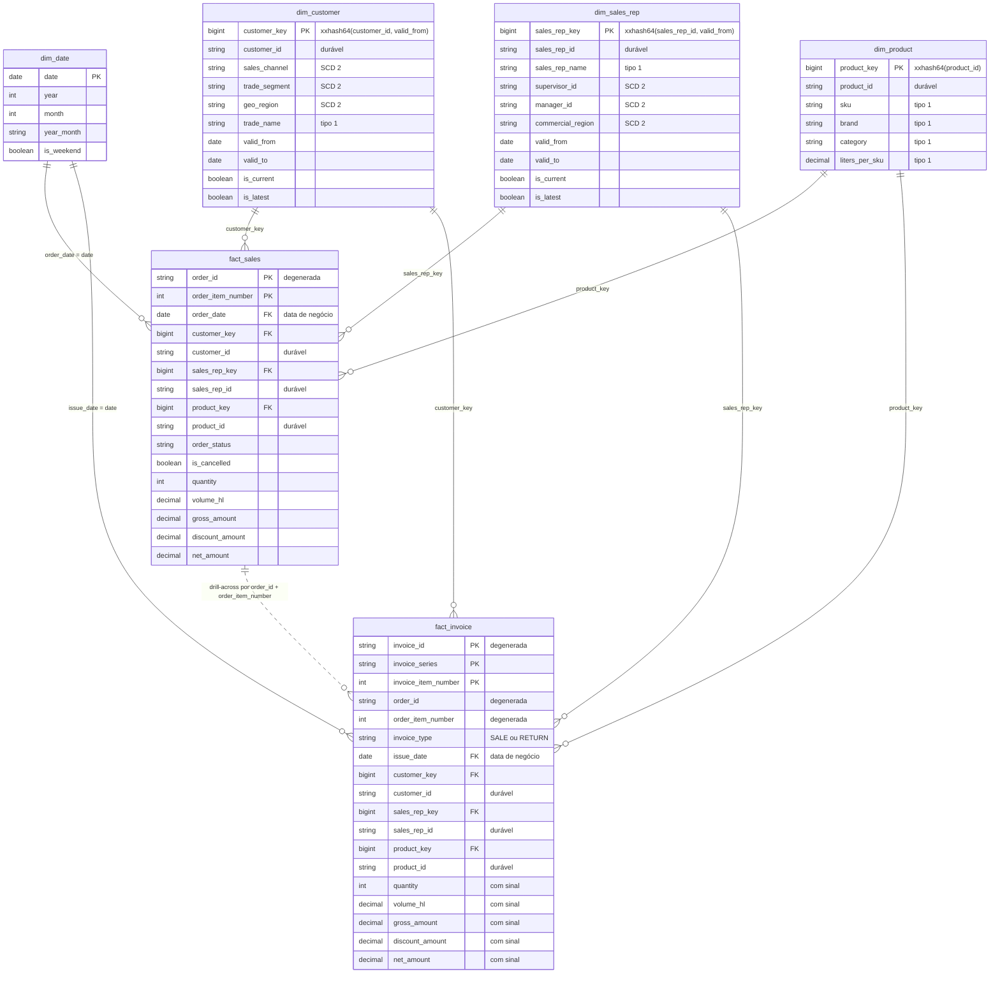

# Modelagem do lakehouse — Serra Azul

> Este documento é a visão consolidada da modelagem em **2026-10-22**, na fatia 1. Ele junta, num lugar só, o que está espalhado em onze ADRs, nas convenções, no dicionário e no código. Os ADRs continuam mandando. Quando houver conflito, valem o ADR (com as emendas aplicadas) e o código.

| Item | Valor |
|---|---|
| **O que cobre** | As dimensões, os fatos, as decisões de modelagem e o porquê de cada uma. Também cobre os tratamentos da silver dos quais a gold depende |
| **O que não faz** | Não decide nada. Toda regra daqui tem um ADR de origem, citado ao lado |
| **Como manter** | Atualizar quando um ADR mudar uma dimensão, um fato ou uma regra da silver usada pela gold. Os números vêm dos ADRs, do [dicionário](dicionario-de-dados-erp.md) ou dos manifestos (`data_gen/erp/manifest_*.json`). Número sem fonte vira "não medido" |
| **Status da fatia 1** | Em andamento. Os pipelines `core` (ADR-0008, 0009) e `commercial` (ADR-0010) estão publicados e executados. Faltam o job `serra_azul_daily` (com a verificação de unicidade e a prova de idempotência), o dashboard e os critérios de pronto ([roadmap](roadmap.md)) |
| **Código** | `src/pipelines/core/{bronze,silver,gold}/`, `src/pipelines/commercial/gold/`, `resources/*.pipeline.yml` |

---

## 1. Visão geral

### 1.1 Medallion e organização

**Até a silver, por fonte. Da gold em diante, por domínio** (ADR-0001, emendado pelo ADR-0004).

| Camada | Onde | O que guarda | Tipo de dataset |
|---|---|---|---|
| Landing | `core.landing` (volumes) | Arquivos como chegam: `/Volumes/core/landing/<fonte>/<dataset>/<AAAA-MM-DD>/` | Parquet |
| Bronze | `core.bronze` | Cópia fiel e *append-only*. **Única camada com PII** | Streaming table (Auto Loader) |
| Silver | `core.silver` | Entidades limpas, deduplicadas e sem PII, ainda alinhadas à fonte | Streaming table com `AUTO CDC` (fatos); materialized view (cadastros) |
| Gold do `core` | `core.gold` | **Somente** dimensões conformadas (`dim_*`) | Materialized view |
| Gold do domínio | `commercial.gold` | Fatos do comercial (`fact_*`) | Materialized view |

**Por que essa divisão:**
- **Cada fonte é ingerida uma vez.** O ERP alimenta o comercial hoje e a logística na fatia 4.
- **Cada entidade compartilhada tem uma definição só.** Cliente e produto aparecem em todas as fatias.
- **O acesso é por domínio**, com um `GRANT` por catálogo e herança de privilégios.

**Execução:** dois pipelines SDP em SQL, `core` (landing → dimensões) e `commercial` (fatos), que rodam em série, com o `core` primeiro (ADR-0002, ADR-0005). O Free Edition limita a **um pipeline ativo por tipo**; o significado exato de "ativo" segue sem teste (ADR-0010). O job `serra_azul_daily`, ainda a entregar, vai garantir a ordem.

### 1.2 O *star schema* da fatia 1

Dois fatos transacionais, um por processo de negócio, e quatro dimensões conformadas. Cada fato guarda, para cliente, vendedor e produto, a `_key` da versão ("como era") e o `_id` durável ("como é hoje"). A data entra direto como `DATE`, sem chave substituta.



A linha pontilhada entre os fatos **não é uma FK**. Ela indica o *drill-across*: os dois fatos se comparam pelo item do pedido, cada um agregado no seu grão antes (seção 5.3).

### 1.3 Linhagem

| Landing (`erp/` ou `ref/`) | Linhas na landing | Bronze → silver (`core`) | Linhas na silver | Gold | Extração |
|---|---|---|---|---|---|
| `pedidos_cab` | 821.048 | `erp_order_header` | 805.153 | `commercial.gold.fact_sales` (cabeçalho desnormalizado) e `commercial.gold.fact_invoice` (vendedor e `order_date` do pedido de origem) | incremental |
| `pedidos_itens` | 2.934.877 | `erp_order_item` | 2.931.839 | `commercial.gold.fact_sales` | incremental |
| `notas_fiscais` | 838.957 | `erp_invoice_header` | 838.957 | `commercial.gold.fact_invoice` | incremental |
| `notas_fiscais_itens` | 3.033.885 | `erp_invoice_item` | 3.017.600 | `commercial.gold.fact_invoice` | incremental |
| `clientes_pdv` | 72.650 | `erp_customer` | 72.650 versões | `core.gold.dim_customer` | full, com o histórico de versões |
| `produtos` | 126 | `erp_product` | 126 versões | `core.gold.dim_product` | full, com o histórico de versões |
| `hierarquia_comercial` | 505 | `erp_sales_hierarchy` | 505 versões | `core.gold.dim_sales_rep` | full, com vigência |
| `cep_municipio` (`ref/`) | 5.005 | `ref_postal_code` | 5.005 | usada em `silver.erp_customer` | carga única |
| — | — | — | — | `core.gold.dim_date` (gerada) | — |

Fontes das contagens: [dicionário](dicionario-de-dados-erp.md), ADR-0008 e ADR-0010. As diferenças entre landing e silver são as deduplicações e os descartes da seção 3.

---

## 2. Princípios de modelagem

Valem para todas as tabelas. Cada um traz a decisão, o porquê, a alternativa descartada e o ADR de origem.

### 2.1 Grão atômico

- **Decisão:** cada fato fica no grão mais fino que a fonte oferece, o item. O `fact_sales` tem uma linha por item de pedido; o `fact_invoice`, uma por item de NF.
- **Por quê:**
  - a marca é atributo do produto, e o produto só aparece no item;
  - do grão atômico sai qualquer agregação (marca, SKU, região, canal); o caminho inverso não existe;
  - o número de pedidos sai de `count(DISTINCT order_id)`, sem precisar de um fato de cabeçalho.
- **Por que não o grão do pedido:** um pedido mistura marcas, e "vendas por marca" ficaria sem resposta.
- **Por que não um fato só, com uma linha por pedido (*accumulating snapshot*):**
  - não representa o faturamento parcial (um item em duas NFs);
  - obriga a escolher uma única data para "ontem";
  - não guarda o valor fiscal, que diverge do pedido em centavos;
  - "desfaz" números publicados quando um pedido faturado é cancelado.
- **Custo assumido:** os atributos do cabeçalho se repetem em cada item, e duas definições de "venda" convivem (seção 5.3).
- **Fonte:** ADR-0003.

### 2.2 Dimensão conformada no `core`, fato no domínio

- **Decisão:**
  - cada entidade compartilhada tem **uma** dimensão, em `core.gold`, com dono técnico;
  - o fato pertence ao domínio que produz o evento (`commercial`);
  - os outros domínios **leem, nunca reconstroem**.
- **Por quê:** "dois números para a mesma pergunta" é o problema que a plataforma existe para resolver. A fatia 2 vai ler a mesma `dim_product` e a demanda do `fact_sales`.
- **Por que não um catálogo por domínio com bronze, silver e gold próprios:** cada fonte seria ingerida várias vezes, dobrando o consumo da cota do Free Edition, e as cópias divergiriam.
- **Contrato da dimensão:**
  - mudança aditiva (coluna nova): o dono aprova e avisa os consumidores;
  - quebra de contrato (renomear ou remover coluna, mudar grão ou regra de SCD): dono e consumidores aprovam, com versão e prazo de depreciação.
- **Fonte:** ADR-0001; nomes das dimensões pelo grão no ADR-0004 §1 (`dim_customer`, e não `dim_pos`; `dim_sales_rep`, e não `dim_sales_hierarchy`).

### 2.3 Identidade antes de histórico

- **Decisão:** antes de escolher o tipo de SCD, a pergunta é: "isto é a mesma coisa mudando, ou outra coisa com o mesmo código?".
  - O SKU reaproveitado é **outra coisa**. A identidade do produto é o `product_id` do ERP, que nunca é reaproveitado, e o `sku` vira atributo.
- **Por quê:** resolvida a identidade, o produto nem precisa de SCD 2 (seção 4.2).
- **Por que não SCD 2 pelo SKU, com o produto novo como versão:** a visão "como é hoje" mandaria vendas da Pilsen para o produto novo, e a série histórica por SKU misturaria dois produtos (problema sério na fatia 5).
- **Por que não uma regra no pipeline para detectar "produto novo":** a heurística erra em *rebranding*. A identidade é responsabilidade da fonte e se resolve por contrato.
- **Fonte:** ADR-0006 §1; [revisão de 2026-10-19](revisao-2026-10-19.md), lição 1.

### 2.4 SCD escolhido por atributo

- **Decisão:** cada atributo decide se gera versão nova (SCD 2) ou se é sobrescrito (tipo 1).

| Dimensão | Geram versão (SCD 2) | Sobrescritos (tipo 1) |
|---|---|---|
| `dim_customer` | tipo de cliente, canal, segmento, endereço, cidade, UF, região geográfica | razão social, nome fantasia, tipo de pessoa, validade do documento, status, data de cadastro |
| `dim_sales_rep` | supervisor, gerente, região comercial | nome do vendedor |
| `dim_product` | nenhum (tipo 1 inteira) | todos |
| `dim_date` | nenhum (tipo 0, gerada) | — |

- **Por quê:** versão nova só quando a mudança importa para a análise "como era". Mudar de região comercial muda a meta do vendedor; trocar de telefone não muda nada.
- **Por que não SCD 2 em todos os atributos:** telefone e grafia gerariam versões sem valor analítico e levariam PII para a gold.
- **Por que não tipo 1 em tudo:** as vendas antigas de um vendedor transferido iriam para a região de hoje. As metas eram da região de antes.
- **Fonte:** ADR-0006 (tabela da Decisão); convenções, "Modelagem".

### 2.5 O histórico vem da vigência do ERP, não da comparação de extrações

- **Decisão:**
  - cada versão é datada pela vigência que o ERP informa (`dt_inicio_vigencia`), e não pelo dia em que a mudança chegou;
  - como cada extração full traz o histórico inteiro, a silver e a dimensão são **recalculadas da extração mais recente** a cada execução.
- **Por quê:**
  - cadastro retroativo fica com a data certa. Na hierarquia, 84 versões foram digitadas depois do início da vigência;
  - os 18 meses de histórico existem desde a primeira carga.
- **Por que não `AUTO CDC ... STORED AS SCD TYPE 2` nem `AUTO CDC FROM SNAPSHOT`:** a sequência seria a data da extração. O histórico começaria no go-live, e o cadastro retroativo ficaria com a data errada. São a ferramenta certa quando a fonte **não** guarda histórico.
- **Custo assumido:**
  - a qualidade da vigência passa a depender do ERP; as regras da seção 3.9 medem sobreposição e buraco;
  - se o ERP reescrever uma versão passada, um mês já reportado pode mudar (seção 8).
- **Fonte:** ADR-0006 §2; ADR-0008 §3; [revisão de 2026-10-19](revisao-2026-10-19.md), lição 2.

### 2.6 Intervalo semiaberto `[valid_from, valid_to)`

- **Decisão:**
  - `valid_to` é o `valid_from` da versão seguinte;
  - a versão aberta tem `valid_to = 9999-12-31`;
  - a junção com o fato é `data >= valid_from AND data < valid_to`.
- **Por quê:** cada dia cai em exatamente uma versão.
- **Por que não `BETWEEN`:** ele fecha as duas pontas. No dia da troca, a venda casaria com as duas versões e seria contada duas vezes.
- **Por que não `valid_to` nulo na versão aberta:** `data < NULL` dá `NULL`, e as vendas da versão atual sumiriam da junção.
- **Na silver:** o ERP manda intervalo fechado (o último dia da versão). A conversão está na seção 3.7.
- **Fonte:** ADR-0006 §3.

### 2.7 Duas chaves no fato: `_key` determinística e `_id` durável (tipo 7 de Kimball)

- **Decisão:**
  - **chave substituta determinística** (`BIGINT`):
    - `customer_key = xxhash64(customer_id, valid_from)`;
    - `sales_rep_key = xxhash64(sales_rep_id, valid_from)`;
    - `product_key = xxhash64(product_id)`;
    - `-1` = membro desconhecido;
  - o fato guarda as duas chaves de cada dimensão: a `_key` aponta para a versão vigente na data ("como era"), e o `_id` é a chave durável ("como é hoje").
- **Por que determinística:** a chave é calculada a partir dos dados, então tem o mesmo valor em toda recomputação ou *full refresh*. É o que permite recalcular os fatos a cada execução (princípio 2.12).
- **Por que não uma coluna `IDENTITY`:** ela renumera as linhas no *full refresh*, e os fatos passariam a apontar para versões erradas.
- **Por que não só a chave natural no fato:** o fato não saberia qual versão vale sem refazer a junção por vigência em cada consulta (princípio 2.8).
- **Por que não um `date_key` inteiro `AAAAMMDD`:** é herança de banco relacional. No Delta, `DATE` é compacto, legível e dispensa conversão.
- **Por que isso é o tipo 7:** Kimball chama de tipo 7 a dimensão "dupla". A chave substituta dá a visão tipo 2 ("como era"); a chave durável, juntada com a versão atual, dá a visão tipo 1 ("como é hoje"). As duas convivem no mesmo fato.
- **Fonte:** ADR-0006 §4 e §5.

### 2.8 As chaves são resolvidas no pipeline, não no BI

- **Decisão:** a junção por vigência roda uma vez por execução, no pipeline `commercial`. O dashboard junta só por igualdade de chave.
- **Por quê:**
  - o Free Edition tem **um** SQL warehouse, de no máximo 2X-Small, dividido entre o dashboard e as consultas *ad-hoc*. Um *range join* a cada clique custaria caro;
  - nenhum consumidor reimplementa a junção, nem o erro do `BETWEEN`.
- **Por que não deixar a junção no dashboard:** o custo se repetiria a cada consulta, e cada consumidor teria a sua versão da regra.
- **Fonte:** ADR-0006 §5.

### 2.9 A data da versão é a do documento que carrega a FK

- **Decisão:** a `_key` de uma dimensão SCD 2 é resolvida na data do documento em que a FK está.

| Fato | Cliente | Vendedor |
|---|---|---|
| `fact_sales` | `order_date` (o pedido carrega o cliente) | `order_date` (o pedido carrega o vendedor) |
| `fact_invoice` | `issue_date` (a NF carrega o cliente, o destinatário fiscal) | `order_date` do pedido de origem (a NF não tem vendedor) |

- **Por quê:**
  - **vendedor da NF na data do pedido:** o vínculo com o vendedor nasce no pedido. Assim, o item tem a mesma região comercial nos dois fatos (seção 5.3);
  - **cliente da NF na data de emissão:** a versão na emissão é a que está impressa na nota, inclusive a UF de destino, que importa para a conciliação fiscal.
- **Por que não o vendedor na `issue_date`:** 255 itens de NF (80 NFs; ~R$ 71,7 mil sem sinal) caíam no `-1`. Eram NFs de vendedores desligados, emitidas de 1 a 19 dias depois do fim da vigência. Além disso, 344 itens mudariam de região comercial entre os dois fatos (R$ 102.550,60 sem sinal). Depois da mudança: 0 no `-1`.
- **Por que não o cliente na `order_date`:** 6 itens ficariam com UF diferente da que consta na NF.
- **Por que não usar a versão `is_latest` como reserva quando não há versão na data:** misturaria "como é hoje" na visão "como era".
- **Fonte:** ADR-0010 D1 e D1b, que precisam a "data do evento" do ADR-0006 §5.

### 2.10 "Como era" e "como é hoje": `is_latest`, não `is_current`

- **Decisão:**
  - **"como era"** (o padrão) = junção pela `_key`;
  - **"como é hoje"** = junção pelo `_id` com a linha `is_latest` da dimensão.

| Coluna | Significa | Quando é `true` |
|---|---|---|
| `is_current` | A versão tem vigência aberta | `valid_to = 9999-12-31` |
| `is_latest` | É a última versão daquele `_id` | maior `version_number` do `_id`, aberta ou não |

- **Por quê:** um vendedor desligado não tem versão aberta. Pela `is_current`, as vendas dele (R$ 6,6 mi em jan–jun/2026, de 6 vendedores) ficariam sem região. A `is_latest` aponta para a última versão conhecida.
- **Exemplo do efeito:** receita do Nordeste em jan–jun/2026 = **R$ 209,2 mi "como era"** × **R$ 197,4 mi "como é hoje"**. Segundo o dicionário (§2), a diferença vem da reorganização de julho/2026, que mandou 6 vendedores do NE para o SE.
- **A mesma regra no tipo 1:** o valor "como é hoje" vem da última versão, e não da `is_current`.
  - a `dim_product` é montada pela última versão de cada produto (ADR-0010 D12);
  - os atributos tipo 1 da `dim_customer` vêm da última versão de cada cliente (ADR-0011; seção 4.3).
- **Fonte:** ADR-0008 §4 (emenda o ADR-0006 §5); ADR-0010 D12; ADR-0011 (emenda o ADR-0006 §2).

### 2.11 Membro desconhecido `-1`, com o motivo exposto

- **Decisão:**
  - nenhuma linha de fato é descartada por falta de dimensão: a `_key` vai para `-1`;
  - `dim_customer`, `dim_sales_rep` e `dim_product` têm uma linha `-1`. A `dim_date` não tem;
  - cada fato tem `_is_customer_id_known` e `_is_sales_rep_id_known`, que separam os dois motivos do `-1`.

| Caso | `_is_<entidade>_id_known` | `_key` | Significado | Origens | O que fazer |
|---|---|---|---|---|---|
| **(a)** | `false` | `-1` | O `_id` não está na dimensão | **Cadastro atrasado** (o esperado; se corrige sozinho na próxima execução); **FK nula** na origem (hoje 0 pedidos); **cliente apagado por LGPD** (fica em `-1` para sempre); **item sem cabeçalho** (contagem dupla, abaixo) | Esperar a carga seguinte. Se não se resolver, investigar FK nula ou exclusão por LGPD |
| **(b)** | `true` | `-1` | O `_id` existe, mas a data do evento cai **fora da vigência total** da entidade: antes do primeiro `valid_from` ou depois do fim da última versão fechada | Exemplo: os 255 itens do princípio 2.9, antes da correção | Verificar se a data do evento é a certa ou se a vigência total no ERP está errada |

- **Um buraco no meio do histórico não gera `-1`.** A dimensão calcula `valid_to = coalesce(lead(valid_from), last_valid_to)`, e a versão anterior se estica, em silêncio, por cima do buraco. Por isso existe a regra `no_gap_to_next_version` na silver (seção 3.9).
- **Contagem dupla, de propósito:** uma linha sem cabeçalho também conta como (a).
  - No `fact_sales`, o item sem pedido conta no (a) do cliente e no (a) do vendedor.
  - No `fact_invoice`, o item sem pedido conta no (a) do vendedor, e o item sem NF, no (a) do cliente.
  - Para ler o (a) puro, subtraia a contagem do cabeçalho correspondente.
- **Por quê:**
  - descartar a linha tiraria faturamento real do fato;
  - como os fatos são recalculados (princípio 2.12), a órfã se corrige sozinha quando o cadastro chega;
  - os dois motivos pedem ações diferentes, e o motivo fica na própria linha.
- **Por que não `INNER JOIN`:** descartaria os itens sem métrica.
- **Por que não um membro `-2` para o caso (b):** todo consumidor teria de conhecer um segundo membro especial, e o motivo ficaria no domínio da chave, e não num atributo.
- **Por que não uma tabela de qualidade separada:** ler o motivo de uma linha exigiria outra junção, com *refresh* próprio.
- **Fonte:** ADR-0006 §6; ADR-0010 D2 e D6.

### 2.12 Fatos como materialized views recalculadas

- **Decisão:** os fatos e as dimensões são materialized views que o SDP recalcula a cada execução, a partir da silver.
- **Por quê:**
  - **idempotência por construção:** a mesma entrada dá a mesma saída. As chaves são `xxhash64`, e o `_updated_at` é o maior `_ingested_at` das linhas de origem, e não o relógio;
  - **órfãs que se corrigem sozinhas:** o cliente que chega atrasado sai do `-1` na execução seguinte, sem reprocesso manual;
  - **barato hoje:** ~6 mi de linhas nos dois fatos. A primeira execução levou 87 s, dos quais 65 s foram arranque.
- **Por que não uma tabela incremental com `MERGE` agora:** não há problema de volume que a justifique (YAGNI). Além disso, o SDP recusou o *refresh* incremental das materialized views (motivos `INPUT_NOT_IN_DELTA` e `EXCESSIVE_OPERATOR_NESTING` no `planning_information`).
- **Por que o `_updated_at` não é `current_timestamp()`:** mudaria a cada execução, e toda linha pareceria alterada.
- **Pendente:** a prova de idempotência (uma segunda execução com números idênticos) fica para o teste do job.
- **Fonte:** ADR-0006 §6 e §9; ADR-0010 D7 e "Perguntas difíceis".

### 2.13 A PII não sai da bronze

- **Decisão:**
  - CNPJ/CPF, nome do responsável, e-mail, telefone e a razão social de pessoa física ficam **só na bronze**, com acesso restrito e a tag `pii = true`;
  - a silver guarda só o resultado da validação do documento (`is_document_valid`) e a `legal_name` apenas de pessoa jurídica.
- **Por quê:** minimização (LGPD, art. 6º, III). O que não é copiado não precisa ser mascarado nem esquecido em várias camadas.
- **Por que não mascarar na silver com *column mask*:** a máscara controla a leitura, mas não reduz o que é guardado. Além disso, depende de recurso não verificado no Free Edition.
- **Por que não guardar um hash do CPF:** sem segredo, o hash é reversível por força bruta (há só ~10⁹ CPFs válidos). Com segredo, é preciso gerir a chave, e nenhuma análise da fatia precisa do documento.
- **Efeito na modelagem:** o direito ao esquecimento apaga o cliente da bronze e da landing (ADR-0007). Ele some da dimensão, e os fatos ficam em `-1` (a) para sempre, com os valores fiscais intactos.
- **Fonte:** ADR-0004 §5; ADR-0007; ADR-0010 D2.

### 2.14 Qualidade por expectations: três ações e nunca `NULL`

- **Decisão:** toda regra tem nome, uma ação e métrica no event log do pipeline.

| Ação | Quando | Exemplo |
|---|---|---|
| `FAIL UPDATE` | Quebra de contrato: sem isso não há deduplicação nem junção | chave natural nula |
| `DROP ROW` | Linha inválida conhecida, que não pode ser publicada | item de pedido com quantidade negativa |
| aviso (sem ação) | Medir sem bloquear | cliente com documento inválido; FK órfã nos fatos |

- **Por quê:** o SLA (D-1 até 8h) favorece não parar a carga por sujeira conhecida. A Controladoria exige que nada errado seja publicado em silêncio. Com métrica em toda regra, nada some sem contagem.
- **Nunca `NULL`:** no SQL, uma comparação com `NULL` dá `NULL`, e não `false` (lógica de três valores). Uma regra que dá `NULL` no caso que deveria contar mede 0 sem ter medido nada. O tratamento de `NULL` pelo SDP não foi verificado, então as regras são escritas para nunca dar `NULL`:
  - `x IS NOT NULL AND ...` quando a regra olha uma coluna;
  - `coalesce(..., false)` numa expressão composta;
  - `x IS DISTINCT FROM v OR ...` quando o nulo deve passar.
- **Por que não `FAIL UPDATE` para toda sujeira:** itens negativos e documentos inválidos derrubariam a carga todo dia e furariam o SLA por um problema já conhecido.
- **Por que não uma tabela de quarentena:** é a prática melhor, e fica para a fatia 3, cujo tema é contrato e quarentena. Aqui, `DROP ROW` com métrica já não é silencioso.
- **Por que não corrigir o sinal dos negativos com `abs()`:** supõe que o erro é sempre de sinal. Sem confirmação do time do ERP, corrigir é inventar dado.
- **Fonte:** ADR-0008 §5; ADR-0010 D14. Lista completa das regras na seção 7.

---

## 3. A silver que sustenta a gold

Só o que a modelagem usa. A silver ainda é **alinhada à fonte**: ela limpa e deduplica, mas não escolhe atributos de SCD nem funde versões. Isso é trabalho da gold.

### 3.1 Fatos: deduplicação por `AUTO CDC` (SCD 1)

**O fluxo de cada tabela de fato:**
1. a bronze (streaming table) entrega as linhas novas;
2. uma *streaming live view* `erp_*_clean` renomeia as colunas para o contrato em inglês, tipa os valores em `DECIMAL(18, 2)` e aplica as expectations;
3. um `AUTO CDC INTO ... STORED AS SCD TYPE 1` mantém **uma linha por chave natural**, a mais recente pelo `SEQUENCE BY`.

| Tabela da silver | `KEYS` | `SEQUENCE BY` |
|---|---|---|
| `erp_order_header` | `order_id` | `STRUCT(_source_updated_at, _status_rank, _ingested_at)` |
| `erp_order_item` | `order_id, order_item_number` | `STRUCT(_source_updated_at, _ingested_at)` |
| `erp_invoice_header` | `invoice_id, invoice_series` | `STRUCT(_source_updated_at, _ingested_at)` |
| `erp_invoice_item` | `invoice_id, invoice_series, invoice_item_number` | `STRUCT(_source_updated_at, _ingested_at)` |

**O que isso resolve** (pedidos: 821.048 linhas na landing → 805.153 pedidos):
- 11.994 duplicatas exatas (reenvio da integração);
- 3.901 quase-duplicatas (a mesma linha com status antigo e `dt_atualizacao` anterior);
- reenvio de arquivo, que vira *upsert* e nunca duplicata.

**O desempate no `SEQUENCE BY`:**
- **O problema:** um pedido faturado no mesmo instante da criação tinha a linha `ABERTO` e a linha final com o **mesmo** `dt_atualizacao`. Com empate, o `AUTO CDC` escolhe de forma arbitrária, e o resultado deixa de ser determinístico.
- **Os números:**
  - na primeira execução, 269 pedidos ficaram `ABERTO` (ADR-0008);
  - no *full refresh* seletivo de 2026-10-21, apareceu o total: **720 pedidos tinham o empate**. Em 451 deles, o `AUTO CDC` escolheu a linha certa por acaso. O ADR-0008 registra só os 269 que ficaram errados;
  - depois da correção: 0 pedidos sem o status mais avançado.
- **A correção:** `_status_rank`, o ciclo de vida do pedido, entra como segundo critério. Um pedido não regride, então, na mesma hora, o status mais avançado vence.

| `order_status` | `_status_rank` |
|---|---|
| `ABERTO` | 1 |
| `PARCIALMENTE FATURADO` | 2 |
| `FATURADO` | 3 |
| `CANCELADO` | 4 (um pedido faturado pode ser cancelado depois; o contrário não acontece) |
| outro | 0 |

- `_ingested_at` é o último critério: no empate total, vence o reenvio mais recente.
- `_status_rank` não é publicado (`COLUMNS * EXCEPT (_status_rank)`).
- **Lição do ADR-0008:** todo `SEQUENCE BY` precisa de desempate.

**Por que não deduplicar na bronze:** a bronze deixaria de ser fiel. Um reenvio apagado não deixaria rastro, e uma regra de dedup errada não teria volta.

**Por que não `ROW_NUMBER()` ou `dropDuplicates`:** não resolvem "a versão mais recente vence" com atualizações tardias, e mantêm estado sem limite. O `AUTO CDC` faz isso de forma declarativa.

Fonte: ADR-0008 §2 e "Achados".

### 3.2 `invoice_type` derivado do CFOP

O ERP não manda o tipo da NF numa coluna própria. Ele vem do CFOP, como num ERP real.

| `cfop` | Operação | `invoice_type` |
|---|---|---|
| `5102`, `6102` | Venda (dentro do estado / para outro estado) | `SALE` |
| `1202`, `2202` | Devolução de venda (dentro do estado / de outro estado) | `RETURN` |
| outro | Sem regra | `NULL` |

- A derivação acontece no cabeçalho (`silver.erp_invoice_header`) e no item (`silver.erp_invoice_item`).
- `known_cfop` (aviso, nas duas tabelas) conta o CFOP sem regra. Hoje: 0.
- **No fato:** CFOP sem regra fica com medidas nulas, fora da soma, e `known_invoice_type` o conta (seção 5.2).
- **Por que não `ELSE 'SALE'`:** uma remessa (CFOP sem regra) viraria faturamento. Uma operação fiscal nova precisa de regra antes de entrar no fato.
- O fato publica o `invoice_type`, e não o `cfop` (ADR-0010 D10).

Fonte: ADR-0008 §2; ADR-0010 D5.

### 3.3 Valores positivos na silver; o sinal é do fato

- Na NF de devolução, os valores chegam **positivos**, como no documento fiscal. A silver os mantém assim.
- O sinal negativo é aplicado **só no `fact_invoice`, uma única vez** (seção 5.2).
- **Por quê:** a silver é alinhada à fonte, e o sinal num lugar só evita a devolução com sinal duplo ou esquecido.
- **No item de pedido**, a silver deriva o bruto: `gross_amount = CAST(quantidade * vl_unitario AS DECIMAL(18, 2))`. O item de NF não tem `gross_amount` na silver; ele é calculado no fato (líquido + desconto).

Fonte: ADR-0003; ADR-0010 D4 e D5.

### 3.4 Regras de descarte

| Regra | Tabela | Expressão | Descartados na carga inicial | Por quê |
|---|---|---|---|---|
| `order_date_not_null` | `erp_order_header` | `order_date IS NOT NULL` | 0 | Sem data de negócio, o pedido não entra em "vendas de ontem" |
| `positive_quantity_and_amount` | `erp_order_item` | `coalesce(quantity > 0 AND net_amount >= 0, false)` | 3.038 | Erro de integração: devolução vem por NF, não por pedido negativo |
| `positive_quantity` | `erp_invoice_item` | `quantity IS NOT NULL AND quantity > 0` | 16.285 | Item fiscal com quantidade zero é inválido |

- **Efeito dos 3.038 itens:** o `fact_sales` soma ~0,1% a menos que o total do cabeçalho do pedido (`order_total_amount`). A diferença é conciliável; a correção definitiva depende do ERP.
- **Os 16.285 itens de quantidade 0** foram um defeito do gerador: no faturamento parcial de um item com 2 unidades, a 2ª NF ficou com 0. Eles formavam 945 NFs "fantasmas", que somavam −R$ 0,61. A regra começou como aviso, foi ela que revelou o defeito, e depois virou `DROP ROW`.
- **Regra nova em streaming table só vale para dados novos.** Para valer no histórico, é preciso um *full refresh* seletivo da silver, reconstruída a partir da bronze. Foi o que se fez em 2026-10-21 com `erp_order_header` e `erp_invoice_item`: a silver de itens de NF passou de 3.033.885 para 3.017.600 linhas.

Fonte: ADR-0008 §5 e "Achados"; ADR-0010 D14 (regras à prova de nulo).

### 3.5 Cadastros: materialized view sobre a última extração

- Cliente, produto e hierarquia são materialized views com o filtro `WHERE _extraction_date = (SELECT max(_extraction_date) FROM bronze.<tabela>)`.
- **Por quê:** cada extração full já contém o histórico inteiro de versões. A extração mais recente basta.
- **Ganho:** uma regra nova vale para todo o histórico na próxima execução, sem *full refresh* (foi assim com a regra do ADR-0009).
- **Custo:** os cadastros são recalculados inteiros a cada execução (~73 mil linhas, barato hoje).
- **A silver de cadastro não é o SCD 2.** Ela é o histórico de versões que o ERP manda, limpo. A escolha dos atributos rastreados e a fusão de versões acontecem na gold (seção 4).

Fonte: ADR-0008 §3; ADR-0006 §2.

### 3.6 Cidade padronizada pelo CEP, antes do cálculo de versões

- `silver.erp_customer` faz `LEFT JOIN silver.ref_postal_code` pelo `postal_code`:
  - `city` = o município da referência, com a grafia oficial;
  - `source_city` = a cidade como foi digitada, guardada para auditoria;
  - `state` = `coalesce(r.state, c.uf)`: a UF da referência, ou a do cadastro se o CEP não estiver nela;
  - `geo_region` = derivada da `state` (SUDESTE, SUL, NORDESTE, CENTRO-OESTE, NORTE).
- **7.264 versões** tinham grafia diferente da do CEP ("Sta Luzia", "Sao Paulo", "B. Horizonte"...).
- **Por que antes das versões:** assim uma correção de grafia nunca vira versão nova na `dim_customer`.
- `postal_code_known` (aviso) conta CEP fora da referência, que deixaria a cidade nula. Hoje: 0.
- A referência tem 5.005 CEPs e cobre 49 municípios. Ela é sintética, gerada junto com os dados.

Fonte: ADR-0006 §8; ADR-0008 §3.

### 3.7 Vigência fechada → semiaberta

O ERP usa intervalo fechado: `dt_fim_vigencia` é o **último** dia da versão, e é nulo na versão vigente. As três silver de cadastro convertem:

| Coluna | Expressão |
|---|---|
| `valid_from` | `dt_inicio_vigencia` |
| `valid_to` | `coalesce(date_add(dt_fim_vigencia, 1), DATE'9999-12-31')` |
| `is_current` | `dt_fim_vigencia IS NULL` |

Exemplo: no ERP, de 2026-01-01 a 2026-03-31; na silver, `[2026-01-01, 2026-04-01)`.

`valid_interval` (aviso) conta versão com `valid_from` nulo ou `valid_to <= valid_from`. Hoje: 0.

Fonte: ADR-0006 §3; [dicionário](dicionario-de-dados-erp.md) §1.

### 3.8 Documento validado e descartado

- `silver.erp_customer` valida o CNPJ/CPF e guarda **só** o booleano `is_document_valid`. O documento fica na bronze.
- O documento é válido quando:
  - tem 11 (CPF) ou 14 (CNPJ) dígitos;
  - **não** tem todos os dígitos iguais (`000.000.000-00` passa no módulo 11, mas é um "documento-coringa"; ADR-0009);
  - os dois dígitos verificadores batem pelo módulo 11.
- A expressão inteira fica num `coalesce(..., false)`: documento nulo ou de tamanho errado dá `false`, nunca `NULL`.
- `document_valid` (aviso) conta **1.336 versões (735 clientes)**.
- **Por que aviso, e não descarte:** o cliente existe e compra. Descartá-lo tiraria vendas reais do fato.
- **CNPJ alfanumérico** (emitido pela Receita desde julho de 2026): não implementado, porque o contrato do ERP é numérico. Se chegar, a linha passa e só o flag fica errado; a contagem do aviso sobe e sinaliza a mudança.
- Na `dim_customer`, `is_document_valid` é tipo 1.

Fonte: ADR-0004 §5; ADR-0008 §3; ADR-0009.

### 3.9 Vigência contígua medida com `_next_valid_from`

- As três silver de cadastro calculam `_next_valid_from`: o `valid_from` da versão seguinte do mesmo id.
  - `lead(dt_inicio_vigencia) OVER (PARTITION BY <id> ORDER BY dt_inicio_vigencia, dt_fim_vigencia NULLS LAST)`;
  - é nulo na última versão, que portanto nunca viola.
- Duas regras de aviso:

| Regra | Expressão | Conta | O que a dimensão faz em silêncio |
|---|---|---|---|
| `no_overlap_with_next_version` | `_next_valid_from IS NULL OR _next_valid_from >= valid_to` | Sobreposição: a versão seguinte começa antes de esta terminar | **Corta** a versão anterior |
| `no_gap_to_next_version` | `_next_valid_from IS NULL OR _next_valid_from <= valid_to` | Buraco: há dias entre o fim desta versão e o início da seguinte | **Estica** a versão anterior por cima do buraco |

- **Por que medir, e não corrigir:** a vigência é do ERP (princípio 2.5). Cortar ou preencher por regra inventaria histórico. O certo é medir e levar o caso ao time do ERP.
- **Por que não `DROP ROW` na versão problemática:** a versão anterior se esticaria por cima da descartada, publicando atributos errados sem métrica.
- **Por que não `FAIL UPDATE`:** pararia a carga diária por um problema que não invalida o resto.
- **Hoje:** 0 sobreposições e 0 buracos em cliente (72.650 versões), vendedor (505) e produto (126), medidos fora do pipeline. A contagem no event log aparece na primeira execução do job.
- **Limitações:** num empate total de início e fim, a linha marcada pode variar entre execuções (a contagem não varia). Uma versão contida em outra mais longa conta como sobreposição e pode aparecer também como um buraco falso.

Fonte: ADR-0010 D11 (emenda o ADR-0008 e cumpre a regra prometida no ADR-0006).

---

## 4. Dimensões

Todas em `core.gold`, como materialized views.

### 4.1 `dim_date`

- **Propósito:** o calendário para agregar por dia, mês, trimestre e dia da semana. Atende "quanto vendi ontem?" e a comparação entre meses (dezembro é o maior mês; fevereiro tem o Carnaval).
- **Grão:** 1 dia.
- **Chave:** `date` (`DATE`). Não há chave substituta: a própria data é a chave e é durável.
- **Histórico:** nenhum (tipo 0). A tabela é gerada por `sequence(DATE'2024-01-01', DATE'2030-12-31')`.

| Coluna | Significado | SCD | Origem |
|---|---|---|---|
| `date` | O dia; chave da dimensão | 0 | `sequence` |
| `year`, `quarter`, `month` | Ano, trimestre e mês | 0 | `year()`, `quarter()`, `month()` |
| `year_month` | `AAAA-MM`, ex.: `2026-10` | 0 | `date_format(d, 'yyyy-MM')` |
| `month_name` | Nome do mês em português | 0 | `CASE` |
| `day_of_month` | Dia do mês | 0 | `day()` |
| `day_of_week` | 1 = domingo … 7 = sábado | 0 | `dayofweek()` |
| `day_name` | Nome do dia em português | 0 | `CASE` |
| `is_weekend` | Sábado ou domingo | 0 | `dayofweek(d) IN (1, 7)` |
| `iso_week` | Semana ISO 8601 | 0 | `weekofyear()` |

- **Membro `-1`:** não existe. Os fatos não têm chave de data; eles guardam a data (`order_date`, `issue_date`) e juntam com `date`. Um item sem cabeçalho tem data nula e não encontra linha.
- **Decisões e porquê:**
  - **intervalo largo, gerado de uma vez:** para não depender de alguém lembrar de recarregar. Cobre o histórico (desde 2025-04-19) e os próximos anos;
  - **sem `date_key` `AAAAMMDD`:** ver princípio 2.7;
  - **feriados e calendário fiscal** ficam para a fatia 5.
- **Números de hoje:** 2.557 linhas, pela conta do intervalo (não medido na tabela).
- **Pegadinha:** não agrupe por `year` e `iso_week` juntos. A semana ISO não respeita a virada do ano civil: 2024-12-30 fica com `year = 2024` e `iso_week = 1` (a semana 1 de 2025). A dimensão não tem o "ano ISO".

Fonte: ADR-0006 (tabela da Decisão); [revisão de 2026-10-19](revisao-2026-10-19.md).

### 4.2 `dim_product`

- **Propósito:** responde "vendas por marca". Também abre por categoria, embalagem e SKU, e fornece os litros por SKU para medir volume em hectolitros.
- **Grão:** 1 produto (`product_id`).
- **Chaves:** substituta `product_key = xxhash64(product_id)`; durável `product_id`.
- **Histórico:** nenhum (tipo 1). Cada produto aparece uma vez, com os atributos da **última versão**.

| Coluna | Significado | SCD | Origem |
|---|---|---|---|
| `product_key` | Chave substituta | — | `xxhash64(product_id)` |
| `product_id` | Identidade do produto (`cod_produto`), nunca reaproveitada | durável | silver |
| `sku` | Código comercial; **pode ser reaproveitado** por outro produto | 1 | silver |
| `ean` | Código de barras; não é chave (há 2 pares duplicados) | 1 | silver |
| `description` | Descrição; mudou de padrão em 2025-11-01 (24 produtos) | 1 | silver |
| `brand` | Marca (5) | 1 | silver |
| `category` | Categoria | 1 | silver |
| `liquid` | Estilo (PILSEN, IPA...) | 1 | silver |
| `package_type` | Embalagem | 1 | silver |
| `unit_volume_ml` | Volume de cada unidade | 1 | silver |
| `units_per_pack` | Unidades por SKU | 1 | silver |
| `liters_per_sku` | Litros por SKU, `DECIMAL(10, 3)`: base do `volume_hl` dos fatos | 1 | derivada na silver: `volume_ml × unidades_pack / 1000` |
| `status` | `ATIVO` / `DESCONTINUADO` | 1 | silver |
| `launch_date` | Início de vendas | 1 | silver |
| `discontinued_date` | Último dia de vendas | 1 | silver |

- **Como é montada:** uma linha por `product_id`, a primeira de `row_number() OVER (PARTITION BY product_id ORDER BY valid_from DESC, valid_to DESC, _source_updated_at DESC)`. Ou seja, a versão que começa por último; no mesmo dia, a que termina depois (a aberta vence); depois, a mais atualizada no ERP.
- **Tratamentos da silver que ela usa:** renomeação, `liters_per_sku`, `positive_volume` (aviso: volume ou pack não positivo) e as regras de vigência da seção 3.9.
- **Membro `-1`:** `product_id = 'N/A'`, `description = 'PRODUTO DESCONHECIDO'`, `brand = 'DESCONHECIDA'`, `liters_per_sku` nulo. No fato, um produto `-1` fica com `volume_hl` nulo: desconhecido não é zero.
- **Decisões e porquê:**
  - **SKU reaproveitado resolvido pela identidade.** Três SKUs (`100536`, `100549`, `100551`) eram de promoções de verão descontinuadas em fev/2026 e foram reusados em produtos novos em mai/2026. Com a identidade pelo `product_id`, são produtos diferentes que compartilham o atributo `sku` (princípio 2.3);
  - **tipo 1, sem histórico:** descrição e EAN alterados são correções. Uma reclassificação de categoria é lida "como é hoje", para comparar períodos sob a mesma árvore de categorias;
  - **última versão, e não `is_current` (ADR-0010 D12):** com `is_current`, um produto cuja última versão foi fechada sumiria da dimensão (vendas no `-1`), e duas versões abertas virariam duas linhas com o mesmo `product_key`, duplicando linhas dos fatos. Medido hoje: 0 e 0. A troca não mudou o conteúdo (`EXCEPT` 0/0);
  - **`liters_per_sku` na dimensão:** o hectolitro é a métrica de volume do setor. Uma caixa de 24 latas e um barril de 50 L não se comparam em "unidades".
- **Números de hoje:** 126 versões na silver → **92 produtos** na dimensão, mais o `-1`. São 89 SKUs, e 82 produtos estavam ativos no fim do período. Produto `-1` nos fatos: 0.
- **Pegadinha:** não junte nada pelo `sku`. Os 3 SKUs reaproveitados apontam para dois produtos cada, e a junção duplicaria linhas. Junte pelo `product_key` (ou `product_id`).

Fonte: ADR-0006 §1 e §4; ADR-0010 D9 e D12; [dicionário](dicionario-de-dados-erp.md) §3.2.

### 4.3 `dim_customer`

- **Propósito:** responde "por canal" (`sales_channel`). Também dá a região geográfica, filtro secundário para a expansão no Nordeste (uma pergunta de mercado), o segmento do PDV e a UF de destino.
- **Grão:** 1 versão **rastreada** de cliente.
- **Chaves:** substituta `customer_key = xxhash64(customer_id, valid_from)`; durável `customer_id`.
- **Histórico:** SCD 2 por atributo.

| Coluna | Significado | SCD | Origem |
|---|---|---|---|
| `customer_key` | Chave substituta da versão | — | `xxhash64(customer_id, valid_from)` |
| `customer_id` | Chave durável (`cod_cliente`) | durável | silver |
| `version_number` | Número da versão do cliente (1, 2...) | — | calculado na gold |
| `customer_type` | `PDV`, `DISTRIBUIDOR` ou `REDE` | **2** | silver (`tipo_cliente`) |
| `sales_channel` | Canal do dashboard: `DIRETO`, `DISTRIBUIDOR`, `REDE` | **2** | derivado na silver do `tipo_cliente` |
| `trade_segment` | Tipo de estabelecimento (`BAR`, `RESTAURANTE`, `MERCADO`...) | **2** | silver (`segmento`) |
| `postal_code`, `street`, `street_number`, `district` | Endereço | **2** | silver |
| `city` | Cidade pela referência de CEP | **2** | silver (seção 3.6) |
| `state` | UF | **2** | silver (seção 3.6) |
| `geo_region` | Região geográfica, derivada da UF | **2** | silver |
| `legal_name` | Razão social, **só de pessoa jurídica** | 1 | silver |
| `trade_name` | Nome fantasia | 1 | silver |
| `person_type` | `J` ou `F` | 1 | silver |
| `is_document_valid` | Documento passa na validação (seção 3.8) | 1 | silver |
| `status` | `ATIVO` / `INATIVO` | 1 | silver |
| `registered_date` | Data de criação do cliente | 1 | silver (`dt_cadastro`) |
| `valid_from`, `valid_to` | Vigência `[valid_from, valid_to)` da versão rastreada | — | calculada na gold |
| `is_current` | Vigência aberta (`valid_to = 9999-12-31`) | — | calculada na gold |
| `is_latest` | Última versão do cliente | — | calculada na gold |

**Como o histórico é construído** (*gaps and islands*):
1. os atributos rastreados de cada versão da silver viram um `named_struct` (`attrs`);
2. uma versão abre ilha nova (`opens_version = 1`) quando `lag(attrs) ... IS DISTINCT FROM attrs`. O `IS DISTINCT FROM` trata `NULL` como valor: `NULL` → `NULL` não é mudança, `NULL` → valor é;
3. a soma acumulada de `opens_version` numera as ilhas (`version_number`);
4. cada ilha vira uma versão: `valid_from = min(valid_from)` e `last_valid_to = max(valid_to)`;
5. `valid_to = coalesce(lead(valid_from), last_valid_to)`, e `is_latest` marca a maior `version_number` do cliente;
6. os atributos de tipo 1 vêm da **última versão** de cada cliente na silver, aberta ou não, e são repetidos em todas as versões. É a primeira linha de `row_number() OVER (PARTITION BY customer_id ORDER BY valid_from DESC, valid_to DESC, _source_updated_at DESC)`, o mesmo desempate da `dim_product` (ADR-0011).

**Exemplo:** três versões na silver.

| Versão na silver | Mudou | Abre versão na gold? |
|---|---|---|
| 2025-05-01 | (primeira) | sim: versão 1 |
| 2025-09-01 | só o telefone (PII, nem chega à silver) e a grafia da cidade, corrigida pelo CEP | não: funde com a versão 1 |
| 2026-02-01 | o endereço | sim: versão 2 |

**Decisões e porquê:**
- **Fusão de versões consecutivas sem mudança rastreada:** só os atributos rastreados geram versão. Resultado: **72.650 versões na silver → 47.166 na `dim_customer`**.
- **Correção de grafia nunca vira versão:** a cidade é padronizada na silver antes do cálculo (seção 3.6). Eram 7.264 versões com grafia divergente.
- **`sales_channel` × `trade_segment`:** o canal do dashboard é o `sales_channel`, os três canais do [caso de negócio](caso-de-negocio.md) §1. A "mudança de canal" do PDV que o dicionário descreve é mudança de `trade_segment` (bar que vira restaurante). A terminologia está no ADR-0010 D1b; no código da `dim_customer`, as duas colunas são rastreadas.
- **Rastreados × tipo 1:** endereço, canal e segmento mudam a análise "como era"; razão social, nome fantasia e status são lidos como estão hoje. Telefone e e-mail não chegam à silver (princípio 2.13).
- **Tipo 1 pela última versão, e não pela `is_current` (ADR-0011):**
  - com `is_current` e `JOIN` interno, um cliente cuja última versão foi fechada sumiria da dimensão com todo o histórico, e as vendas dele iriam para o `-1` (a), com motivo falso;
  - duas versões abertas com inícios diferentes duplicariam cada `customer_key`, e o `LEFT JOIN` dos fatos duplicaria as linhas (*fan-out*);
  - agora, um cliente encerrado fica com `is_current = false` em todas as linhas e `is_latest = true` na última. As vendas depois do fim da vigência vão para o (b), o motivo certo;
  - **continua aberto:** duas versões com o **mesmo início** e atributos rastreados diferentes ainda geram a mesma `customer_key` (seção 8);
  - medido em 2026-10-22: 0 clientes sem versão aberta, 0 com duas abertas, 0 com a última versão fechada e 0 com atributo tipo 1 diferente entre as duas regras. Um teste com casos literais confirmou os dois defeitos na lógica antiga e a correção na nova. Depois do refresh (`9430ea`), a dimensão ficou idêntica: 47.167 linhas e o mesmo checksum.
- **Inativado não é encerrado:** `status = 'INATIVO'` é tipo 1, e vigência fechada é outra coisa. Em 2026-10-22, os 1.234 clientes `INATIVO` tinham todos versão aberta: o ERP inativa com uma versão nova e não fecha a vigência. Não espere clientes `INATIVO` no `-1` (b) (ADR-0011).
- **Por que não SCD 2 em todos os atributos:** ver princípio 2.4.

**Membro `-1`:** `customer_id = 'N/A'`, `trade_name = 'CLIENTE DESCONHECIDO'`, canal e segmento `'DESCONHECIDO'`, cidade, UF e região `'DESCONHECIDA'`, vigência `[1900-01-01, 9999-12-31)`, `is_current` e `is_latest` verdadeiros.

**Números de hoje:**
- 39.773 clientes e 72.650 versões na silver → 47.166 versões na dimensão;
- na silver, 17.429 clientes com 1 versão, 13.838 com 2 e 8.506 com 3 ou mais;
- 1.336 versões (735 clientes) com documento inválido;
- 227 clientes ainda fora do cadastro (313 pedidos): no `fact_sales`, 1.070 itens em `-1` (a); no `fact_invoice`, 1.084.

**Pegadinha:** a região geográfica **não** é a região do dashboard. As duas redes nacionais têm sede em SP, então o Sudeste fica com 56% do volume geográfico. Na visão comercial, esse volume é de CONTAS NACIONAIS. A região do dashboard vem da `dim_sales_rep` (seção 4.4).

Fonte: ADR-0006 (tabela da Decisão, §2, §8); ADR-0008 §4; ADR-0010 D1b; ADR-0011; [dicionário](dicionario-de-dados-erp.md) §2 e §3.1.

### 4.4 `dim_sales_rep`

- **Propósito:** dá a **região comercial**, a região padrão do dashboard. Também dá supervisor e gerente, e atende o critério de pronto da fatia: "quem era o supervisor do vendedor X na data D?".
- **Grão:** 1 versão de vendedor.
- **Chaves:** substituta `sales_rep_key = xxhash64(sales_rep_id, valid_from)`; durável `sales_rep_id`.
- **Histórico:** SCD 2.

| Coluna | Significado | SCD | Origem |
|---|---|---|---|
| `sales_rep_key` | Chave substituta da versão | — | `xxhash64(sales_rep_id, valid_from)` |
| `sales_rep_id` | Chave durável (`cod_vendedor`) | durável | silver |
| `sales_rep_name` | Nome do vendedor, o da versão mais recente | 1 | `max_by(sales_rep_name, valid_from)` |
| `version_number` | Número da versão | — | calculado na gold |
| `supervisor_id`, `supervisor_name` | Supervisor da equipe | **2** | silver |
| `manager_id`, `manager_name` | Gerente regional | **2** | silver |
| `commercial_region` | SUDESTE, SUL, NORDESTE, CENTRO-OESTE, NORTE ou CONTAS NACIONAIS | **2** | silver |
| `valid_from`, `valid_to` | Vigência `[valid_from, valid_to)` | — | calculada na gold |
| `is_current` | Vigência aberta | — | calculada na gold |
| `is_latest` | Última versão do vendedor, mesmo sem vigência aberta | — | calculada na gold |

- **Como o histórico é construído:** o mesmo *gaps and islands* da `dim_customer`, com os cinco atributos rastreados no `named_struct`. Os nomes do supervisor e do gerente fazem parte do conjunto rastreado.
- **Tratamentos da silver que ela usa:** vigência pela data de início no ERP, e não pela data de registro (`registered_date`). A silver guarda também `is_retroactive` (`dt_registro > dt_inicio_vigencia`), só para auditoria. As regras de vigência estão na seção 3.9.
- **Membro `-1`:** `sales_rep_id = 'N/A'`, `sales_rep_name = 'VENDEDOR DESCONHECIDO'`, `commercial_region = 'DESCONHECIDA'`, vigência `[1900-01-01, 9999-12-31)`.

**Decisões e porquê:**
- **A região comercial é a região do dashboard (ADR-0006 §7):**
  - as metas são definidas para a estrutura comercial;
  - as contas nacionais (as duas redes, 26,2% do volume em hl) são atendidas por um time que não segue a geografia;
  - vale a região **como era na data da venda**. O vendedor que foi do NE para o SE em julho deixa as vendas de janeiro no NE. A visão "como é hoje" está disponível pelo `sales_rep_id`.
- **Reorganizações retroativas com a data certa:** 84 versões foram digitadas depois do início da vigência e ficam com a vigência certa (princípio 2.5).
- **Vendedores desligados e `is_latest`:** 6 vendedores desligados não têm versão aberta. A `is_latest` aponta para a última versão, e as vendas deles (R$ 6,6 mi em jan–jun/2026) não ficam sem região na visão "como é hoje" (princípio 2.10).
- **Buraco legítimo:** um vendedor recontratado teria um buraco de verdade na vigência. A dimensão estica a versão anterior por cima dele. A decisão de respeitar o buraco fica para o primeiro caso real (hoje 0; ADR-0010 D11).
- **Critério de pronto:** "quem era o supervisor do vendedor X na data D" é uma consulta simples à dimensão e devolve exatamente uma linha (ADR-0008; consulta na seção 6.4).

**Números de hoje:**
- 505 versões, 146 vendedores e 140 com versão vigente na silver; 21 supervisores;
- linhas na dimensão depois da fusão: não medido;
- vendedor `-1` nos fatos: 0 (a) e 0 (b) nos dois fatos.

**Pegadinha:** filtrar `is_current` para a visão "como é hoje" tira os 6 desligados do resultado. Use `is_latest`.

Fonte: ADR-0006 (tabela da Decisão, §7); ADR-0008 §4; ADR-0010 D1 e D11; [dicionário](dicionario-de-dados-erp.md) §3.3.

---

## 5. Fatos

Os dois em `commercial.gold`, como materialized views do pipeline `commercial`. Eles leem `${catalog_core}.silver.*` e `${catalog_core}.gold.dim_*` e não reconstroem nada do `core`.

### 5.1 `fact_sales`

- **Stakeholder:** Diretor Comercial. **Pergunta:** "quanto vendi ontem, por região, marca e canal?". SLA: D-1 até 8h. A comparação com a meta ainda não tem dataset de metas na fatia 1.
- **Grão:** 1 item de pedido. **Chave natural:** `(order_id, order_item_number)`.
- **Data de negócio:** `order_date`. É a **demanda capturada**, no dia em que o pedido foi tirado.
- **Origem:** `silver.erp_order_item` com `LEFT JOIN silver.erp_order_header` (o cabeçalho é desnormalizado no item).

| Coluna | Papel | Regra |
|---|---|---|
| `order_id` | Degenerada (grão) | Do item |
| `order_item_number` | Degenerada (grão) | Do item |
| `order_date` | Data de negócio | Do cabeçalho. Nula se o cabeçalho não existe |
| `customer_key` | Dimensão (versão) | Versão vigente na `order_date`; `-1` se não houver |
| `customer_id` | Dimensão (durável) | Do cabeçalho |
| `sales_rep_key` | Dimensão (versão) | Versão vigente na `order_date`; `-1` se não houver |
| `sales_rep_id` | Dimensão (durável) | Do cabeçalho |
| `product_key` | Dimensão | Por `product_id` (SCD 1); `-1` se não houver |
| `product_id` | Dimensão (durável) | Do item |
| `order_status` | Atributo | `ABERTO`, `PARCIALMENTE FATURADO`, `FATURADO`, `CANCELADO` |
| `is_cancelled` | Atributo | `order_status = 'CANCELADO'` |
| `quantity` | Medida aditiva | Unidades de SKU |
| `volume_hl` | Medida aditiva | `quantity × liters_per_sku / 100`, `DECIMAL(18, 5)`; nulo se o produto é `-1` |
| `gross_amount` | Medida aditiva | `quantity × unit_price`, calculado na silver |
| `discount_amount` | Medida aditiva | Do ERP |
| `net_amount` | Medida aditiva | Do ERP (`vl_total_item`) |
| `_is_customer_id_known` | Técnica | `customer_id` existe na dimensão (motivo do `-1`) |
| `_is_sales_rep_id_known` | Técnica | `sales_rep_id` existe na dimensão |
| `_updated_at` | Técnica | Maior `_ingested_at` entre o item e o cabeçalho |

**Como as chaves são resolvidas:**
- cliente e vendedor: `LEFT JOIN` na dimensão por `_id` e `order_date >= valid_from AND order_date < valid_to`, com `coalesce(..., -1)`;
- produto: `LEFT JOIN` por `product_id`;
- o motivo do `-1`: `LEFT JOIN` numa lista dos `_id` existentes na dimensão (`customer_ids`, `sales_rep_ids`).

**Regras das medidas:**
- **Bruto − desconto = líquido.** Aqui a conta já fecha na fonte: o `vl_total_item` é `quantidade × vl_unitario − vl_desconto`. A regra `amounts_add_up` vigia a igualdade (hoje 0 violações).
- **Sem sinal:** pedido não tem devolução. Os itens negativos foram descartados na silver (seção 3.4).
- **Cancelados ficam no fato**, com `order_status` e `is_cancelled`. O dashboard filtra; o histórico fica preservado.
- **`volume_hl` em `DECIMAL(18, 5)`:** `liters_per_sku` tem 3 casas; dividido por 100, dá no máximo 5. Com 2 casas, uma caixa de 12 latas de 350 ml (0,042 hl) viraria 0,04, um erro de ~5%. `DOUBLE` não soma de forma exata.
- **Fora do fato (YAGNI, ADR-0010 D10):**
  - `unit_price`: não é aditivo. Preço médio = `sum(net_amount) / sum(quantity)`;
  - `order_total_amount`: medida de cabeçalho, repetida em cada item, somaria errado.

**Expectations (todas de aviso, 7):** `order_header_found`, `amounts_add_up`, `customer_id_in_dimension`, `customer_version_valid_on_order_date`, `sales_rep_id_in_dimension`, `sales_rep_version_valid_on_order_date`, `product_id_in_dimension`. As contagens estão na seção 7.

**Números de hoje (primeira execução, 2026-10-21):**

| Conferência | Valor |
|---|---|
| Linhas (= silver) | 2.931.839 |
| Chaves nulas / duplicatas no grão | 0 / 0 |
| Soma de `net_amount`, todas as linhas (= silver) | R$ 3.916.105.322,30 |
| Volume | 4.200.325 hl |
| Cliente `-1` (a) / (b) | 1.070 / 0 |
| Vendedor `-1` (a) / (b) | 0 / 0 |
| Produto `-1` | 0 |

Fonte: ADR-0003; ADR-0006 §5, §6 e §9; ADR-0010 (contrato, D4, D6, D7, D9, D10 e resultados).

### 5.2 `fact_invoice`

- **Stakeholder:** Controladoria (CFO). **Pergunta:** "faturamento, preço médio praticado e desconto por canal, batendo com o fiscal". Precisão vale mais que velocidade.
- **Grão:** 1 item de NF. **Chave natural:** `(invoice_id, invoice_series, invoice_item_number)`, a mesma da fonte (`num_nf` + `serie` + `item_nf`). Hoje a série é sempre `1`, mas o grão não depende disso (ADR-0010 D8).
- **Data de negócio:** `issue_date`, a data de emissão da NF.
- **Origem:** `silver.erp_invoice_item`, com `LEFT JOIN` em `silver.erp_invoice_header` (data e cliente) e em `silver.erp_order_header` (vendedor e `order_date` do pedido de origem).

| Coluna | Papel | Regra |
|---|---|---|
| `invoice_id`, `invoice_series`, `invoice_item_number` | Degeneradas (grão) | Do item |
| `order_id`, `order_item_number` | Degeneradas (ligação) | O item de pedido que está sendo faturado ou devolvido |
| `invoice_type` | Atributo | `SALE` ou `RETURN`, derivado do CFOP na silver; nulo se o CFOP não tem regra |
| `issue_date` | Data de negócio | Do cabeçalho da NF. Nula se o cabeçalho não existe |
| `customer_key` | Dimensão (versão) | Versão vigente na **`issue_date`** |
| `customer_id` | Dimensão (durável) | Do cabeçalho da **NF** (o destinatário fiscal) |
| `sales_rep_key` | Dimensão (versão) | Versão vigente na **`order_date` do pedido de origem** |
| `sales_rep_id` | Dimensão (durável) | Do cabeçalho do **pedido** (a NF não tem vendedor) |
| `product_key`, `product_id` | Dimensão | Do item da NF, por `product_id` |
| `quantity` | Medida aditiva, com sinal | Unidades de SKU |
| `volume_hl` | Medida aditiva, com sinal | `DECIMAL(18, 5)`; nulo se o produto é `-1` |
| `gross_amount` | Medida aditiva, com sinal | **`net_amount + discount_amount`** |
| `discount_amount` | Medida aditiva, com sinal | Do item da NF |
| `net_amount` | Medida aditiva, com sinal | Valor fiscal do item |
| `_is_order_header_found` | Técnica | O pedido de origem está na silver (`order_date IS NOT NULL`) |
| `_is_customer_id_known`, `_is_sales_rep_id_known` | Técnicas | Motivo do `-1` |
| `_updated_at` | Técnica | Maior `_ingested_at` entre o item da NF, o cabeçalho da NF e o cabeçalho do pedido |

**Como as chaves são resolvidas:** como no `fact_sales`, mas cada dimensão na data do documento que carrega a FK (princípio 2.9):
- cliente: `issue_date >= valid_from AND issue_date < valid_to`;
- vendedor: `order_date >= valid_from AND order_date < valid_to`. A `order_date` é usada na junção, mas não é publicada: seria uma segunda data de negócio, sem pergunta que a peça;
- produto: por `product_id`.

**Regras das medidas:**
- **Sinal das devoluções:** `sign = CASE invoice_type WHEN 'SALE' THEN 1 WHEN 'RETURN' THEN -1 END`, aplicado a `quantity`, `volume_hl` e aos três valores. A soma já é o faturamento líquido de devoluções.
- **CFOP sem regra:** `invoice_type` nulo dá `sign` nulo, e as medidas ficam nulas. A linha fica fora da soma até ganhar regra, e `known_invoice_type` a conta. Com `ELSE 1`, uma remessa viraria faturamento; com `ELSE 0`, a linha se esconderia dentro das somas.
- **Bruto = líquido + desconto (ADR-0010 D4):** o fiscal manda. Em ~3% dos itens (89.555 na silver), o valor do item diverge do pedido em ±1 a 3 centavos. Com `quantity × unit_price`, essas linhas teriam bruto − desconto ≠ líquido no dashboard da Controladoria. Custo: nesses itens, bruto ÷ quantidade difere do preço unitário em centavos.
- **Cancelamento depois do faturamento:** o pedido tem uma NF de venda e uma de devolução. No `fact_invoice`, as duas se anulam (2.200 pedidos).
- **Fora do fato (YAGNI, ADR-0010 D10):**
  - `unit_price`: não é aditivo;
  - `cfop`: o fato usa o `invoice_type`;
  - `original_invoice_id`: a conciliação da devolução é item a item, por `order_id` + `order_item_number`.

**Medido em 2026-10-21 (efeito das datas de versão):**
- **vendedor:** 14.520 itens de NF mudam de versão do vendedor entre a data do pedido e a da emissão. Em 344 deles, muda a região comercial (R$ 102.550,60 sem sinal);
- **cliente:** em 252 itens (R$ 75.777,35 sem sinal), a versão na `order_date` difere da versão na `issue_date`.

| Atributo do cliente que muda | Itens |
|---|---|
| Endereço | 209 |
| Segmento (`trade_segment`) | 43 |
| UF | 6 |
| Canal (`sales_channel`) | 0 |
| Região geográfica | 0 |

**Expectations (todas de aviso, 8):** `invoice_header_found`, `order_header_found`, `known_invoice_type`, `customer_id_in_dimension`, `customer_version_valid_on_issue_date`, `sales_rep_id_in_dimension`, `sales_rep_version_valid_on_order_date`, `product_id_in_dimension`. As contagens estão na seção 7.

**Números de hoje (primeira execução, 2026-10-21):**

| Conferência | Valor |
|---|---|
| Linhas (= silver) | 3.017.600 |
| Chaves nulas / duplicatas no grão | 0 / 0 |
| Soma de `net_amount`, com sinal (= silver) | R$ 3.825.572.385,53 |
| NFs de devolução (silver) | 11.158 de 838.957 |
| Bruto − desconto ≠ líquido | 0 linhas |
| Devolução não negativa | 0 linhas |
| Cliente `-1` (a) / (b) | 1.084 / 0 |
| Vendedor `-1` (a) / (b) | 0 / 0 |
| Produto `-1` | 0 |
| Volume | não medido |

Fonte: ADR-0003; ADR-0006 §9; ADR-0010 (contrato, D1 a D10 e resultados).

### 5.3 Os dois fatos juntos

**Duas definições de "venda", de propósito (ADR-0003):**

| | `fact_sales` | `fact_invoice` |
|---|---|---|
| O que mede | Demanda capturada | Faturamento fiscal |
| Quem lê | Diretor Comercial | Controladoria |
| Data | `order_date` | `issue_date` |
| Devoluções | não existem | linhas `RETURN`, com sinal negativo |
| Cancelados | ficam, com `is_cancelled`; o dashboard filtra | NF de venda e de devolução se anulam |
| Valores | do pedido | do documento fiscal (centavos podem divergir) |

Os totais não batem, e não devem bater. Entre um e outro há pedidos cancelados (18.190, dos quais 2.200 depois de faturar), devoluções (11.158 NFs), pedidos ainda abertos ou parcialmente faturados (141 e 130), a defasagem entre a data do pedido e a da emissão e os centavos. O dashboard precisa dizer qual número é qual.

***Drill-across* pelo item do pedido:**
- `order_id` + `order_item_number` ligam cada item de NF ao item de pedido faturado ou devolvido. Isso concilia o faturamento parcial (um item em duas NFs) e as devoluções item a item.
- **Regra do *drill-across*:** agregue cada fato até o grão comum **antes** de juntar. O `fact_sales` tem uma linha por item de pedido, mas o `fact_invoice` pode ter várias (parcial, devolução). Juntar os dois no grão atômico multiplicaria as linhas do pedido (*fan-out*). Exemplo na seção 6.5.

**A região comercial é a mesma nos dois fatos:**
- o vendedor do item de NF vem do pedido e é resolvido na `order_date`, a mesma data e a mesma versão do `fact_sales` (princípio 2.9);
- se fosse resolvido na emissão, 344 itens cairiam em outra região (R$ 102.550,60), e o *drill-across* por região não fecharia item a item;
- **consequência:** no faturamento mensal por região, vale a estrutura comercial da data do pedido.

**O cliente pode diferir entre os fatos:** o `fact_invoice` usa a versão da emissão. Hoje, o segmento difere em 43 itens; o canal e a região geográfica, em 0. Se o dashboard passar a comparar segmento ou canal entre os fatos, a medição deve ser refeita (ADR-0010 D1b).

---

## 6. Como consultar

Os exemplos usam os nomes do workspace (`core`, `commercial`). No código dos pipelines, os catálogos vêm de `${catalog_core}` / `${catalog_commercial}`. Os dados vão de 2025-04-19 a 2026-10-18; o D-1 da carga inicial é 2026-10-18.

### 6.1 "Como era" e "como é hoje"

```sql
-- "Como era" (padrão): a região comercial do vendedor na data do pedido.
-- JOIN simples pela _key não perde linha: todo fato aponta para uma linha da dimensão, nem que seja a -1.
SELECT r.commercial_region, sum(f.net_amount) AS net_amount
FROM commercial.gold.fact_sales f
JOIN core.gold.dim_sales_rep r ON r.sales_rep_key = f.sales_rep_key
WHERE f.order_date >= DATE'2026-01-01' AND f.order_date < DATE'2026-07-01'
  AND NOT f.is_cancelled
GROUP BY r.commercial_region;

-- "Como é hoje": a região da última versão do mesmo vendedor.
-- LEFT JOIN pelo _id + is_latest; o coalesce mantém as linhas (a), cujo _id não está na dimensão.
SELECT coalesce(r.commercial_region, 'DESCONHECIDA') AS commercial_region, sum(f.net_amount) AS net_amount
FROM commercial.gold.fact_sales f
LEFT JOIN core.gold.dim_sales_rep r ON r.sales_rep_id = f.sales_rep_id AND r.is_latest
WHERE f.order_date >= DATE'2026-01-01' AND f.order_date < DATE'2026-07-01'
  AND NOT f.is_cancelled
GROUP BY 1;
```

### 6.2 Vendas D-1 por região, marca e canal

```sql
SELECT r.commercial_region,               -- região comercial, "como era" (ADR-0006 §7)
       p.brand,
       c.sales_channel,                   -- DIRETO, DISTRIBUIDOR, REDE
       sum(f.net_amount)          AS net_amount,
       sum(f.volume_hl)           AS volume_hl,
       count(DISTINCT f.order_id) AS orders
FROM commercial.gold.fact_sales f
JOIN core.gold.dim_sales_rep r ON r.sales_rep_key = f.sales_rep_key
JOIN core.gold.dim_product   p ON p.product_key   = f.product_key
JOIN core.gold.dim_customer  c ON c.customer_key  = f.customer_key
WHERE f.order_date = DATE'2026-10-18'     -- no job diário: date_sub(current_date(), 1)
  AND NOT f.is_cancelled
GROUP BY ALL;
```

### 6.3 Preço médio e taxa de desconto

Razão de somas, nunca média de razões. Por produto, porque `quantity` é em unidades de SKU: somar caixas de lata com barris não dá um preço com sentido.

```sql
SELECT c.sales_channel,
       p.product_id,
       p.description,
       sum(f.net_amount)      / nullif(sum(f.quantity), 0)     AS avg_net_price,
       sum(f.discount_amount) / nullif(sum(f.gross_amount), 0) AS discount_rate
FROM commercial.gold.fact_invoice f
JOIN core.gold.dim_customer c ON c.customer_key = f.customer_key
JOIN core.gold.dim_product  p ON p.product_key  = f.product_key
WHERE f.issue_date >= DATE'2026-09-01' AND f.issue_date < DATE'2026-10-01'
GROUP BY ALL;
```

No `fact_invoice`, a soma já desconta as devoluções. Para olhar só as vendas, filtre `invoice_type = 'SALE'`.

### 6.4 Critério de pronto: quem era o supervisor do vendedor X na data D

```sql
SELECT sales_rep_id, sales_rep_name, supervisor_id, supervisor_name, commercial_region, valid_from, valid_to
FROM core.gold.dim_sales_rep
WHERE sales_rep_id = 'V0001'
  AND DATE'2026-03-15' >= valid_from
  AND DATE'2026-03-15' <  valid_to;   -- intervalo semiaberto: exatamente uma linha
```

### 6.5 *Drill-across*: pedido × faturado

```sql
-- Por item: agregue cada fato no grão comum antes de juntar.
WITH ordered AS (
  SELECT order_id, order_item_number, quantity AS qty_ordered, net_amount AS net_ordered
  FROM commercial.gold.fact_sales                          -- já é 1 linha por item de pedido
),
invoiced AS (
  SELECT order_id, order_item_number,
         sum(quantity) AS qty_invoiced, sum(net_amount) AS net_invoiced
  FROM commercial.gold.fact_invoice                        -- várias linhas por item: parcial, devolução
  GROUP BY order_id, order_item_number
)
SELECT o.*, i.qty_invoiced, i.net_invoiced
FROM ordered o
LEFT JOIN invoiced i USING (order_id, order_item_number);

-- Por região: cada fato pela sua data de negócio, depois junta pela região.
WITH s AS (
  SELECT r.commercial_region, sum(f.net_amount) AS ordered
  FROM commercial.gold.fact_sales f
  JOIN core.gold.dim_sales_rep r ON r.sales_rep_key = f.sales_rep_key
  WHERE f.order_date >= DATE'2026-09-01' AND f.order_date < DATE'2026-10-01' AND NOT f.is_cancelled
  GROUP BY 1
),
i AS (
  SELECT r.commercial_region, sum(f.net_amount) AS invoiced
  FROM commercial.gold.fact_invoice f
  JOIN core.gold.dim_sales_rep r ON r.sales_rep_key = f.sales_rep_key
  WHERE f.issue_date >= DATE'2026-09-01' AND f.issue_date < DATE'2026-10-01'
  GROUP BY 1
)
SELECT * FROM s FULL OUTER JOIN i USING (commercial_region);
```

### 6.6 Erros comuns

| Erro | O que acontece | Certo |
|---|---|---|
| Juntar com a dimensão pelo `_id` sem `is_latest` | Cada linha do fato se multiplica pelo número de versões do `_id` | Pela `_key` ("como era") ou pelo `_id` com `AND is_latest` ("como é hoje") |
| Usar `is_current` no "como é hoje" | Os 6 vendedores desligados ficam sem região (R$ 6,6 mi em jan–jun/2026) | `is_latest` |
| `INNER JOIN` pelo `_id` no "como é hoje" | As linhas (a) somem: 1.070 itens no `fact_sales` | `LEFT JOIN` + `coalesce` |
| `BETWEEN valid_from AND valid_to` numa junção por data | No dia da troca, a linha casa com duas versões e é contada duas vezes | `data >= valid_from AND data < valid_to` |
| Média de preço por linha: `avg(net_amount / quantity)` | Uma caixa pesa o mesmo que 500 | `sum(net_amount) / sum(quantity)` |
| Somar `quantity` de produtos diferentes | Caixa de lata + barril | `volume_hl` |
| Esquecer os cancelados no `fact_sales` | Venda que não existe mais entra no "ontem" | `NOT is_cancelled` |
| `count(*)` para contar pedidos ou NFs | Conta itens | `count(DISTINCT order_id)`; NFs: `count(DISTINCT invoice_id, invoice_series)` |
| `count(*)` para medir o faturamento no `fact_invoice` | Conta as linhas de CFOP sem regra, cujas medidas são nulas (o `sum` as ignora) | Somar as medidas; para achar o caso, `invoice_type IS NULL` |
| Juntar `fact_sales` e `fact_invoice` no grão atômico | *Fan-out*: o item com parcial ou devolução é contado várias vezes | Agregar cada fato antes (seção 6.5) |
| Agrupar por `year` e `iso_week` | 2024-12-30 vira a semana 1 de 2024 | `year_month` ou a própria data |

---

## 7. Qualidade no modelo

Todas as expectations que afetam dimensões e fatos. "Aviso" = só mede. As tabelas `erp_*` e `ref_*` ficam em `core.silver`; os fatos, em `commercial.gold`. As dimensões não têm expectations próprias: as regras dos cadastros ficam na silver. As contagens são da carga inicial (ADR-0008, ADR-0009, ADR-0010); as regras que entraram ou mudaram em 2026-10-21 foram medidas fora do pipeline e aparecem no event log na primeira execução do job.

| Tabela | Regra | Ação | Por quê | Contagem atual |
|---|---|---|---|---|
| `erp_order_header` | `order_id_not_null` | `FAIL UPDATE` | Sem chave não há dedup nem junção | 0 |
| `erp_order_header` | `order_date_not_null` | `DROP ROW` | Sem data, o pedido não entra em "vendas de ontem" | 0 |
| `erp_order_header` | `known_status` | aviso | Status novo no ERP é mudança de contrato | 0 |
| `erp_order_item` | `order_item_key_not_null` | `FAIL UPDATE` | Quebra de contrato | 0 |
| `erp_order_item` | `positive_quantity_and_amount` | `DROP ROW` | Erro de integração; devolução vem por NF | 3.038 |
| `erp_invoice_header` | `invoice_key_not_null` | `FAIL UPDATE` | Quebra de contrato | 0 |
| `erp_invoice_header` | `known_cfop` | aviso | Operação fiscal nova precisa de regra | 0 |
| `erp_invoice_header` | `return_has_original_invoice` | aviso | Devolução deve referenciar a venda | 0 |
| `erp_invoice_item` | `invoice_item_key_not_null` | `FAIL UPDATE` | Quebra de contrato | 0 |
| `erp_invoice_item` | `known_cfop` | aviso | Operação fiscal nova precisa de regra | 0 |
| `erp_invoice_item` | `positive_quantity` | `DROP ROW` | Item fiscal com quantidade zero é inválido | 16.285 |
| `erp_customer` | `customer_id_not_null` | `FAIL UPDATE` | Quebra de contrato | 0 |
| `erp_customer` | `document_valid` | aviso | O cliente existe e compra; o flag vai para a dimensão | 1.336 versões (735 clientes) |
| `erp_customer` | `postal_code_known` | aviso | Cidade ficaria nula; referência incompleta | 0 |
| `erp_product` | `product_id_not_null` | `FAIL UPDATE` | Quebra de contrato | 0 |
| `erp_product` | `positive_volume` | aviso | Mede volume ou pack não positivo, a base do `liters_per_sku` | não registrada |
| `erp_sales_hierarchy` | `sales_rep_id_not_null` | `FAIL UPDATE` | Quebra de contrato | 0 |
| `erp_sales_hierarchy` | `known_region` | aviso | Mede região comercial fora das 6 do contrato | não registrada |
| `ref_postal_code` | `postal_code_not_null` | `FAIL UPDATE` | Quebra de contrato | 0 |
| cadastros (3) | `valid_interval` | aviso | Vigência invertida ou sem início é erro de cadastro | 0 |
| cadastros (3) | `no_overlap_with_next_version` | aviso | A dimensão cortaria a versão em silêncio | 0 |
| cadastros (3) | `no_gap_to_next_version` | aviso | A dimensão esticaria a versão em silêncio | 0 |
| `fact_sales`, `fact_invoice` | `order_header_found` | aviso | Item sem o pedido (fica com data ou vendedor nulo) | 0 / 0 |
| `fact_invoice` | `invoice_header_found` | aviso | Item de NF sem a NF | 0 |
| `fact_invoice` | `known_invoice_type` | aviso | CFOP sem regra, com medidas nulas | 0 |
| `fact_sales` | `amounts_add_up` | aviso | Bruto − desconto ≠ líquido | 0 |
| `fact_sales`, `fact_invoice` | `customer_id_in_dimension` | aviso | Cliente (a) | 1.070 / 1.084 |
| `fact_sales` / `fact_invoice` | `customer_version_valid_on_order_date` / `..._on_issue_date` | aviso | Cliente (b) | 0 / 0 |
| `fact_sales`, `fact_invoice` | `sales_rep_id_in_dimension` | aviso | Vendedor (a) | 0 / 0 |
| `fact_sales`, `fact_invoice` | `sales_rep_version_valid_on_order_date` | aviso | Vendedor (b) | 0 / 0 |
| `fact_sales`, `fact_invoice` | `product_id_in_dimension` | aviso | Produto (a); o produto não tem (b), porque a junção não usa data | 0 / 0 |

**Por que as regras dos fatos ficam no próprio fato, e não numa view intermediária:**
- a documentação oficial diz que as métricas de expectation de uma view podem não estar disponíveis (*"might not be available"*);
- a regra no fato mede exatamente o que é publicado, inclusive colunas que só existem no resultado final (`_is_*` e as chaves).

É uma versão leve da *audit dimension* de Kimball (ADR-0010 D2).

---

## 8. Limitações e dívidas conhecidas

| Limitação | Efeito hoje | Origem | O que muda / em produção |
|---|---|---|---|
| **Recomputação sem incremental** | Fatos (~6 mi de linhas) e cadastros (~73 mil) recalculados inteiros a cada execução. O SDP recusou o incremental (`INPUT_NOT_IN_DELTA`, `EXCESSIVE_OPERATOR_NESTING`) | ADR-0006, ADR-0008, ADR-0010 | Em 10x (~60 mi), 5 a 10 min de processamento, estimados. Em 100x, incremental obrigatório: fatos como streaming tables com `AUTO CDC` e reprocesso do `-1`, ou MVs intermediárias |
| **Event log no schema do domínio** | Tabela `event_log_*` em `commercial.gold` (e em `core.bronze`). Com o `GRANT` no catálogo, todo consumidor lê o event log | ADR-0010 | Schema técnico na fatia 2 (observabilidade) |
| **Unicidade sem verificação automática** | O `LEFT JOIN` só conserva a contagem se a `_key` for única. Hoje: 0 duplicatas, medidas à mão | ADR-0010 D13 | Tarefa final do job `serra_azul_daily` |
| **Idempotência sem prova** | A segunda execução com números idênticos não foi feita | ADR-0010 | Teste do job |
| **ERP que reescreve vigência passada** | Um mês já reportado pode mudar | ADR-0006 | Se o negócio exigir relatórios fechados: *snapshot* mensal congelado |
| **LGPD: `-1` para sempre** | O cliente esquecido fica em `-1` (a), e o (a) deixa de ser só "cadastro atrasado" | ADR-0010 D2 | Desejado: valores fiscais sem PII |
| **Contagem dupla nas regras do `-1`** | Item sem cabeçalho conta em mais de uma regra; o (a) puro sai por subtração | ADR-0010 D2 | Tornar os motivos exclusivos, se atrapalhar a leitura |
| **Tabela de preço fora da fatia 1** | Sem análise contra o preço de lista; o desconto vem do item da NF | ADR-0006 §10 | Entra quando a análise for pedida |
| **Buraco legítimo na hierarquia** | Um vendedor recontratado teria a versão anterior esticada por cima do buraco | ADR-0010 D11 | Decidir no primeiro caso real (hoje 0) |
| **Atributos tipo 1 da `dim_customer` pela versão aberta (resolvido)** | Nenhum. Os atributos tipo 1 vinham de `silver.erp_customer WHERE is_current`, com `JOIN` interno: um cliente sem versão aberta sumiria da dimensão **com todas as versões** (vendas no `-1` (a)), e duas versões abertas duplicariam a `customer_key`. Medido em 2026-10-22: 0 clientes sem versão aberta, 0 com duas abertas e 0 com a última versão fechada | Achado na escrita deste documento (2026-10-21) | **Resolvido pelo [ADR-0011](adr/0011-dim-customer-tipo-1-pela-ultima-versao.md)** (2026-10-22): tipo 1 pela última versão de cada cliente, como a `dim_product` (ADR-0010 D12). Refresh `9430ea`: dimensão idêntica (47.167 linhas, mesmo checksum) |
| **Mesmo início duplica a `_key` (`dim_customer` e `dim_sales_rep`)** | Duas versões da silver com o mesmo `customer_id` e `valid_from` e atributos rastreados diferentes abrem duas versões com a mesma `customer_key = xxhash64(customer_id, valid_from)`; uma fica com o intervalo vazio `[d, d)`, e a escolha da aberta e da `is_latest` não é determinística. A junção por vigência não duplica; a junção pela `_key` ("como era") duplica. A `dim_sales_rep` usa a mesma chave e o mesmo cálculo de versões, então tem o mesmo caminho (`sales_rep_key`). Hoje: 0 nas duas, contado por `no_overlap_with_next_version` | Chave do ADR-0006 §4; registrado no ADR-0011 | Prevenir (deduplicação determinística na dimensão) ou só detectar (ADR-0010 D13, a entregar com o job): decidir no ADR do job |
| **`_updated_at` e órfã resolvida** | Uma troca de chave causada só pela dimensão não muda o `_updated_at`; um consumidor incremental guiado por ele perde a correção | ADR-0010 D7 | — |
| **Sem quarentena** | Linhas descartadas ficam só como métrica (`DROP ROW`) | ADR-0008 | Fatia 3 (contratos e quarentena) |
| **Fonte atrasada** | Se o extrato de pedidos ou NFs atrasar, o D-1 fica incompleto **sem aviso** | ADR-0010 "Perguntas difíceis" | Detecção de *freshness* na fatia 2 |
| **Regra nova em streaming table** | Só vale para dados novos; no histórico, exige *full refresh* seletivo | ADR-0008 | Testar regras antes, com *validate-only* e amostra |
| **`fact_sales` ~0,1% abaixo do cabeçalho** | Os 3.038 itens negativos descartados | ADR-0008 | Correção na fonte (ERP) |
| **CNPJ alfanumérico** | Seria marcado como inválido | ADR-0009 | Implementar quando o contrato do ERP mudar |

---

## 9. O que vem nas próximas fatias

Só o que muda a modelagem.

- **Fatia 2 — supply chain:** o primeiro fato de ***periodic snapshot*** (estoque CD × SKU × dia). O estoque é **semiaditivo**: soma entre CDs e SKUs, mas não soma no tempo. Dias faltantes no snapshot terão de ser sinalizados, e não zerados. A demanda média vem do `fact_sales`, lido e nunca reconstruído.
- **Fatia 4 — logística:** o teste real do grão da fatia 1, com a junção pedido → entrega. Aparece o *skew*: as 2 redes concentram 26,2% do volume em 2 `customer_id`. É também onde entram o *liquid clustering* por data nos fatos e a medição de antes e depois. Um *accumulating snapshot* do ciclo pedido → faturamento → entrega é candidato (ADR-0003).
- **Fatia 5 — data science:** ***point-in-time correctness***. As features por SKU × CD × semana precisam usar a versão vigente em cada data, sem vazamento de dados futuros. A `_key` "como era" já é uma junção *point-in-time*; feriados e calendário fiscal entram na `dim_date`.

---

## 10. Glossário

| Termo | Significado |
|---|---|
| **Grão** | O que uma linha da tabela representa. Declarado antes de qualquer coluna |
| **Dimensão conformada** | Uma dimensão só por entidade, compartilhada por todos os fatos e domínios |
| **Dimensão degenerada** | Identificador de documento guardado no fato, sem tabela de dimensão própria (`order_id`, `invoice_id`) |
| **Chave natural** | A chave que vem da fonte (`cod_cliente`) |
| **Chave durável** | A chave natural que identifica a entidade ao longo de todas as versões (`customer_id`). Nunca é reaproveitada |
| **Chave substituta** | Chave criada no lakehouse, uma por versão (`customer_key`). Aqui é determinística (`xxhash64`) |
| **SCD 0** | O atributo nunca muda (`dim_date`) |
| **SCD 1** | A mudança sobrescreve o valor; não há histórico |
| **SCD 2** | A mudança cria uma versão nova, com vigência |
| **SCD 7** | Kimball: o fato guarda a chave substituta ("como era") e a chave durável ("como é hoje") |
| **Membro desconhecido** | A linha `-1` da dimensão, para onde vai o fato sem correspondência |
| ***Late-arriving dimension*** | O cadastro chega depois do fato que o referencia |
| **Intervalo semiaberto** | `[início, fim)`: inclui o início e exclui o fim. Cada data cai em exatamente uma versão |
| ***Gaps and islands*** | Técnica de janela para agrupar linhas consecutivas iguais ("ilhas"); aqui, para fundir versões |
| ***Drill-across*** | Comparar fatos diferentes por dimensões em comum, agregando cada um antes de juntar |
| ***Fan-out*** | Multiplicação de linhas numa junção um-para-muitos, que infla as somas |
| **Expectation** | Regra de qualidade do SDP, com nome, ação e métrica |

---

## 11. Referências

| Documento | Uma linha |
|---|---|
| [ADR-0001](adr/0001-organizacao-de-catalogos-e-schemas.md) | Catálogo `core` alinhado à fonte e catálogos por domínio para a gold |
| [ADR-0002](adr/0002-motor-de-transformacao.md) | Lakeflow SDP em SQL como motor de transformação |
| [ADR-0003](adr/0003-fatos-de-vendas-e-faturamento.md) | Dois fatos transacionais no grão do item: pedido e NF |
| [ADR-0004](adr/0004-ajustes-de-organizacao-nomes-landing-e-pii.md) | Nomes pelo grão, prefixo de fonte até a silver, landing por dataset e PII por minimização |
| [ADR-0005](adr/0005-orquestracao-por-job-e-codigo-em-bundle.md) | Job `serra_azul_daily`, Git e bundle |
| [ADR-0006](adr/0006-dimensoes-conformadas-identidade-scd-e-chaves.md) | Dimensões: identidade, SCD por atributo, vigência do ERP, chaves determinísticas, membro `-1` |
| [ADR-0007](adr/0007-retencao-da-bronze-por-tipo-de-extracao.md) | Retenção da bronze pelo tipo de extração |
| [ADR-0008](adr/0008-pipeline-core-deduplicacao-qualidade-e-cadastros.md) | Pipeline `core`: bronze fiel, dedup por `AUTO CDC`, cadastros recalculados, expectations, `is_latest` |
| [ADR-0009](adr/0009-validacao-de-documento-digitos-repetidos-e-cnpj-alfanumerico.md) | Documento com dígitos repetidos é inválido; CNPJ alfanumérico adiado |
| [ADR-0010](adr/0010-pipeline-commercial-fatos-chaves-e-membro-desconhecido.md) | Pipeline `commercial`: data da versão, motivo do `-1`, sinal, bruto, regras de vigência, nunca `NULL` |
| [ADR-0011](adr/0011-dim-customer-tipo-1-pela-ultima-versao.md) | Atributos tipo 1 da `dim_customer` pela última versão de cada cliente, e não pela versão aberta |
| [Convenções](convencoes.md) | Regras em vigor em uma página |
| [Dicionário de dados do ERP](dicionario-de-dados-erp.md) | Colunas da fonte, sujeiras e contagens da carga inicial |
| [Caso de negócio](caso-de-negocio.md) | Empresa, stakeholders, fontes e requisitos |
| [Revisão de 2026-10-19](revisao-2026-10-19.md) | Releitura das decisões da fase 0 e lições de método |
